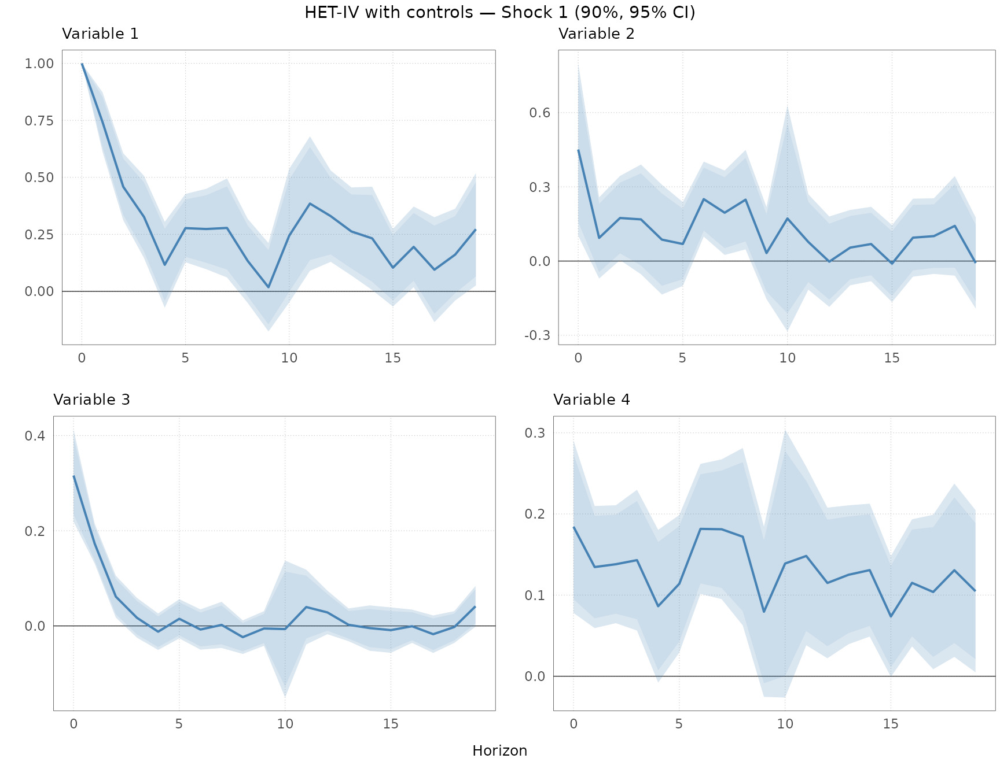
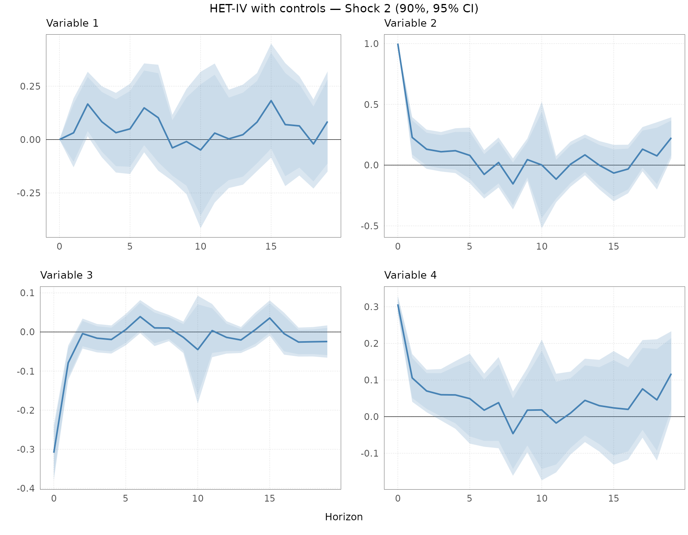
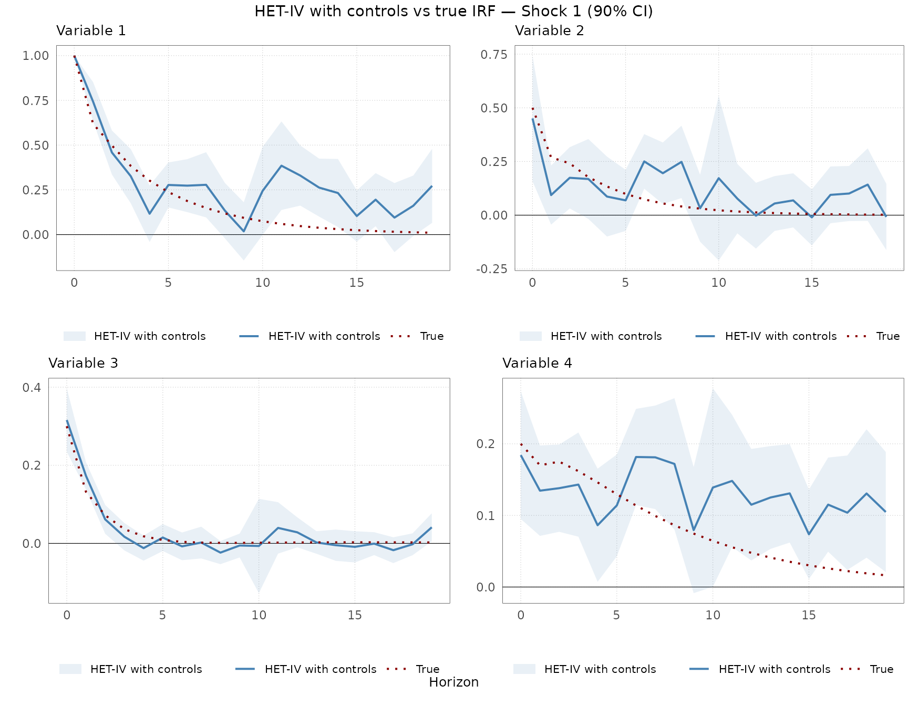
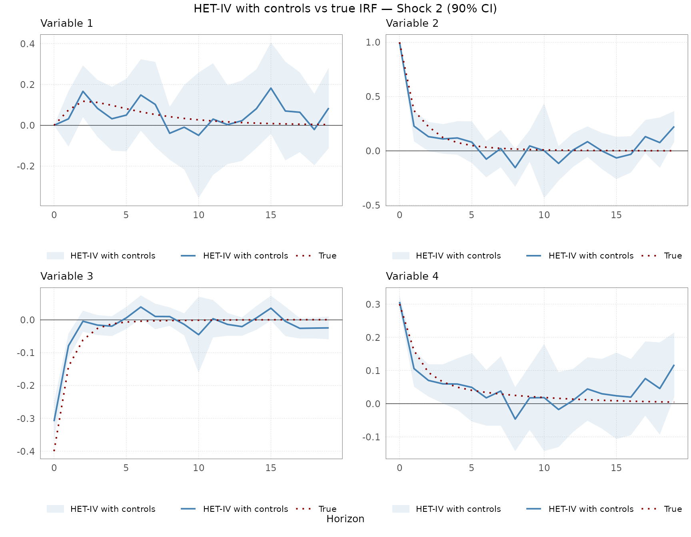
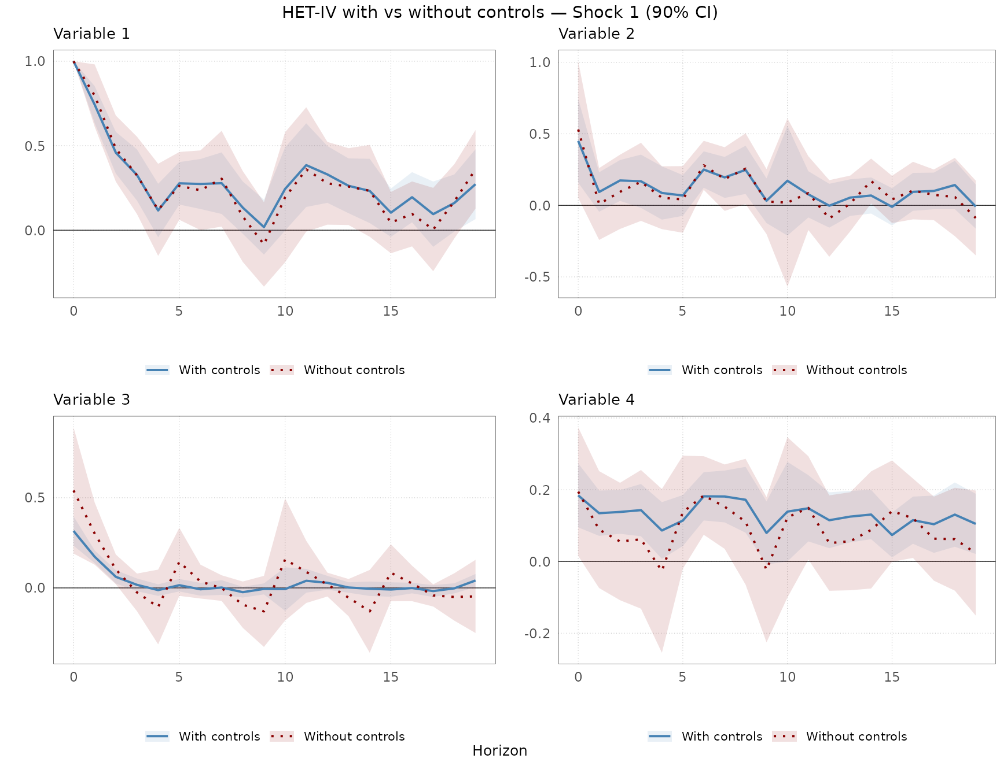
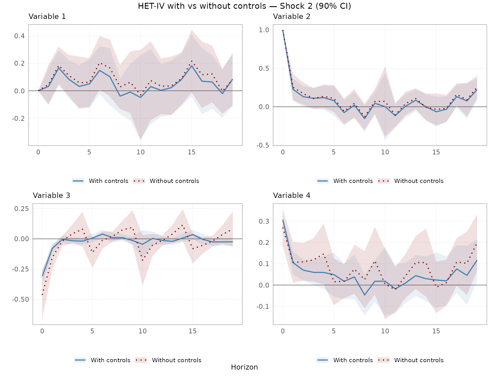
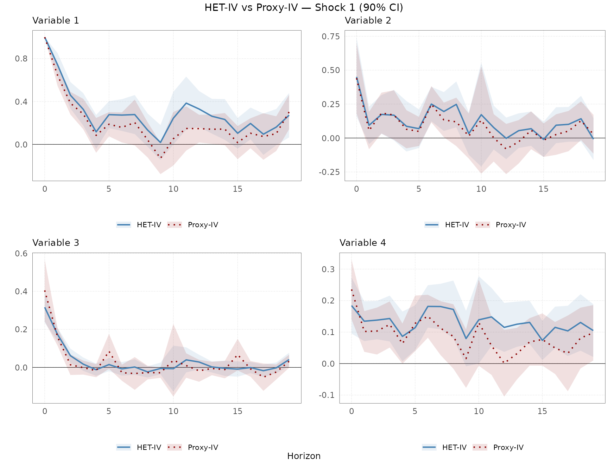
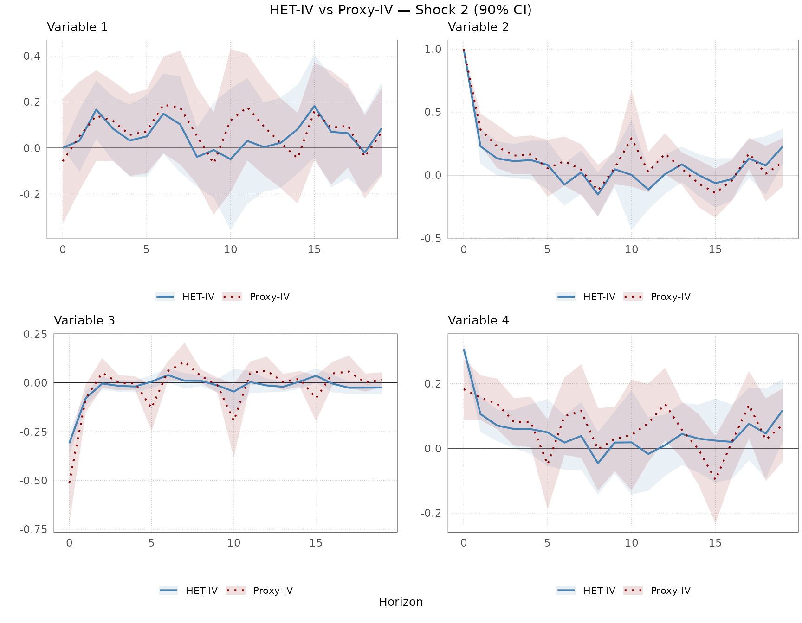
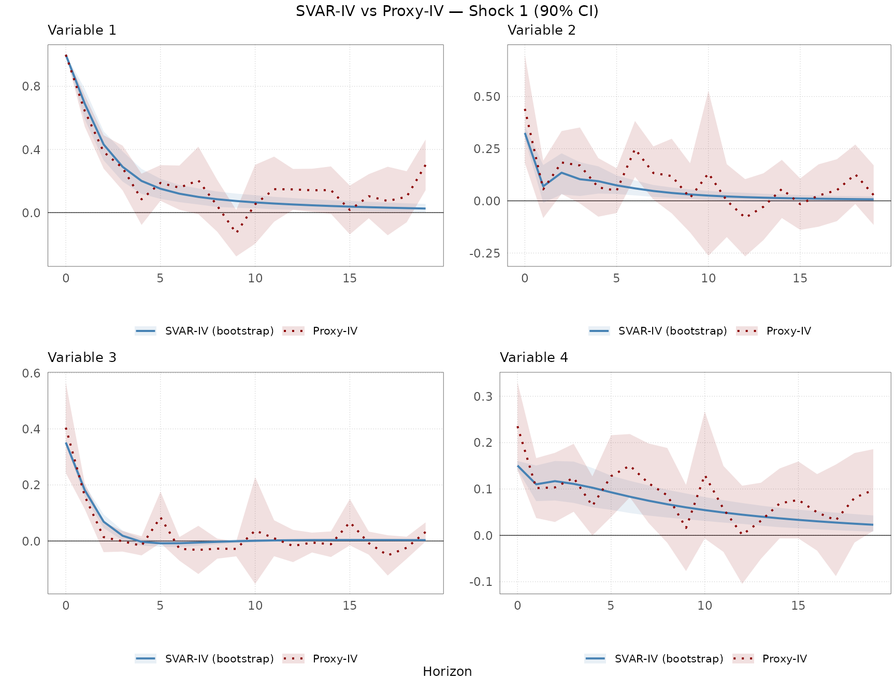
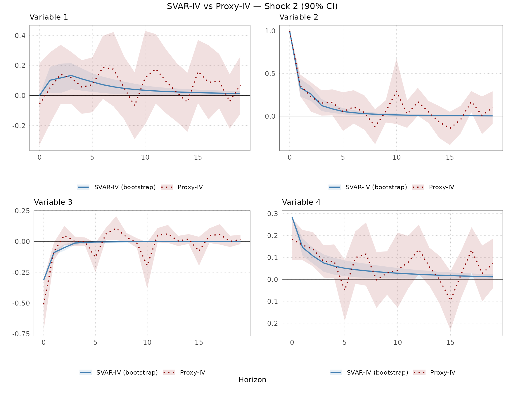

# Estimating Dynamic Causal Effects with hetiv

## Introduction

**hetiv** provides tools for measuring and identifying multi-dimensional
structural shocks in dynamic models using two complementary IV
approaches:

- **Heteroskedasticity-IV** (Rigobon 2003, Rigobon and Sack 2004, Lewis
  2022, Burri and Kaufmann, 2026b): exploits the higher variance of
  outcome variables on policy event days relative to control days to
  identify structural shocks without requiring external instruments.
- **Proxy-IV** (Mertens and Ravn 2013, Stock and Watson 2018): uses an
  external instrument (proxy) that is correlated with the shock of
  interest but uncorrelated with other shocks.

Both approaches are implemented as local projection IV estimators
following Jordà (2005), which directly produce impulse response
functions (IRFs) across multiple horizons. Inference is based on
heteroskedasticity-robust standard errors by default. Montiel Olea et
al. (2025) show that these standard errors suffice for local-projection
impulse responses under weak conditions, even though multi-step forecast
errors are typically serially correlated. Newey-West HAC standard errors
are also available via `cov_type = "NW"` as an optional robustness
check.

The package allows for multiple shocks and endogenous variables.
Weak-instrument HAR inference is implemented via the generalised minimum
eigenvalue test of Lewis and Mertens (2025), which nests the classical
Stock-Yogo (2005) test for the univariate homoskedastic case.
[`gweakivtest()`](https://dankaufmann.github.io/hetiv/reference/gweakivtest.md)
is a direct port of the Matlab files by Lewis and Mertens (2025)
available on **<https://karelmertens.com/research/>**.

In addition, the package provides
[`kfpredict()`](https://dankaufmann.github.io/hetiv/reference/kfpredict.md)
for predicting the underlying unobserved shocks based on the Kalman
filter, as suggested by Burri and Kaufmann (2026a).

This vignette demonstrates the functionality using a simulated
four-variable VAR with two structural shocks.

## Simulated data

We simulate data from a VAR(2) with \\N = 4\\ variables, \\E = 2\\ event
(policy) shocks, \\R = 2\\ regular shocks, and \\P = 2\\ lags over \\T =
500\\ observations. The model reads:

\\y_t = \Psi \varepsilon_t + \Gamma v_t + \Phi(L) y\_{t-1} + \beta X_t
\\ \\ \text{for } t\in \mathcal{P}\\

\\y_t = \Gamma v_t + \Phi(L) y\_{t-1} + \beta X_t \\ \\ \text{for } t\in
\mathcal{C}\\

where \\\mathcal{P}, \mathcal{C}\\ denote policy event and other days,
respectively, \\\Psi\\ is the impact matrix of \\E\\ policy event shocks
and \\\Gamma\\ the impact matrix of \\R\\ other shocks. \\\Phi(L)\\ is a
conformable lag polynomial, and \\X_t\\ is a matrix of deterministic
terms.

Regular shocks occur on all days. A policy event occurs every 10th
period (approximately 10% of observations). The latter introduces
heteroskedasticity in the variance-covariance matrix of the reduced-form
residuals
[`hetiv()`](https://dankaufmann.github.io/hetiv/reference/hetiv.md)
exploits to identify the impulse response functions. Shocks are drawn
from a standard normal distribution. The impact matrix is
lower-triangular, corresponding to the identifying assumption by Burri
and Kaufmann (2026b) that the first shock has a contemporaneous effect
on all variables, while the second shock has no contemporaneous effect
on the first variable. Deterministic weekday patterns are added to
variables 3 and 4 to illustrate the role of controls. The event
indicator `Ind` equals 1 on policy event days and 0 on control days.

``` r

library(hetiv)

# Dimensions
N <- 4 # variables
E <- 2 # event shocks
R <- 2 # regular shocks
P <- 2 # VAR lag order
H <- 20 # IRF horizons
Nevn <- 10 # Frequency of event shocks

# Impact matrix for event shocks (N x E); lower triangular for recursive ID
PsiE <- matrix(0, N, E)
PsiE[, 1] <- c(1.0, 0.5, 0.3, 0.2)
PsiE[, 2] <- c(0.0, 1.0, -0.4, 0.3)

SigE <- 4 # event shock variance (scalar, applies to all E shocks)

# Impact matrix for regular shocks (N x R)
PsiR <- matrix(0, N, R)
PsiR[, 1] <- c(1.0, -0.3, 0.2, 0.1)
PsiR[, 2] <- c(0.2, 1.0, -0.1, 0.4)

# VAR coefficient matrices at lags 1 and 2
Phi <- array(0, dim = c(N, N, P))
Phi[, , 1] <- matrix(c(
  0.60, 0.05, -0.04, 0.03,
  0.06, 0.40, 0.05, -0.03,
  -0.05, 0.04, 0.50, 0.06,
  0.03, -0.03, 0.05, 0.70
), N, N, byrow = TRUE)
Phi[, , 2] <- matrix(c(
  0.10, 0.03, -0.02, 0.02,
  0.04, 0.10, 0.03, -0.02,
  -0.03, 0.02, 0.10, 0.03,
  0.02, -0.02, 0.03, 0.10
), N, N, byrow = TRUE)

# Simulate — seed is set internally by simulatedata()
Nobs <- 500
Nbin <- 100
sim <- simulatedata(
  Phi = Phi, SigE = SigE, PsiE = PsiE, PsiR = PsiR,
  Nobs = Nobs, Nbin = Nbin, N = N, R = R, E = E,
  Nevn = Nevn, P = P, eDist = 0, seed = 42
)

# Extract simulated data and event indicator
y_data <- sim$y
Ind <- as.integer(sim$IndE[, 1])

# Add deterministic weekday variation into variables 3 and 4
y_data[, 3] <- y_data[, 3] + 0.5 * seq_len(Nobs) %% 5
y_data[, 4] <- y_data[, 4] + 0.3 * seq_len(Nobs) %% 5
```

To illustrate the proxy-IV approach, we construct a noisy external
instrument for the two event shocks by adding Gaussian noise to the true
shocks. The proxy is set to zero on control days. This mirrors the
convention of the proxy-SVAR literature (Mertens and Ravn, 2013; Gertler
and Karadi, 2015), where high-frequency surprises are recorded around
policy announcement windows and set to zero otherwise. Setting the proxy
to `NA` on control days instead excludes those days from the proxy-IV
regressions and reproduces the announcement-day sample of the
event-study literature (Nakamura and Steinsson, 2018). Both conventions
use the same identifying moments, because the first-stage and
reduced-form cross products involve event days only; they differ in the
sample used to estimate the control coefficients. We use zeros as the
default convention.

``` r

# RNG state after simulatedata(seed = 42) is deterministic, so no extra seed needed
e_proxy <- sim$eE
e_proxy[, 1] <- e_proxy[, 1] + rnorm(Nobs, sd = 1)
e_proxy[, 2] <- e_proxy[, 2] + rnorm(Nobs, sd = 1)
e_proxy[Ind == 0, ] <- 0
```

## Estimation

### Heteroskedasticity-IV without controls

First, we estimate a misspecified model, failing to control for lagged
dependent variables and weekday-variation. Note that we impose a
normalization on the impact on the endogenous variable for every shock.
The value of the normalization can be chosen by `norm`. Here, we choose
the normalization that corresponds to the true impact matrix.

``` r

res_het <- hetiv(
  y       = y_data,
  O       = y_data,
  Ind     = Ind,
  P       = 0,
  H       = H,
  E       = E,
  norm    = 1,
  details = TRUE
)
```

### Heteroskedasticity-IV with controls

Second, we estimate the correctly specified model, with \\P = 2\\ lags
and the weekday dummies. Note that the weekday dummies absorb the
deterministic pattern that we added to the data. The regressions
generally include a constant term. Therefore, we only add four weekday
dummies.

``` r

# Weekday dummies: four indicator variables (one left out as reference)
X_data <- matrix(0, nrow = Nobs, ncol = 4)
for (i in 1:4) X_data[, i] <- as.integer((seq_len(Nobs)) %% 5 == (i - 1))

res_het_X <- hetiv(
  y       = y_data,
  O       = y_data,
  X       = X_data,
  Ind     = Ind,
  P       = P,
  H       = H,
  E       = E,
  norm    = 1,
  details = TRUE
)
```

### Proxy-IV

Third, we use the external instrument to estimate the model via
proxy-IV. The same lags are included as in the second model. However,
the weekday dummies are dropped due to collinearity, as only the event
days are used to identify the responses. Note that the proxy-IV function
still requires `Ind` as an input, because, in case the instrument is
missing, but `Ind = 1`, we can later on predict the unobserved shock
using the Kalman filter with
[`kfpredict()`](https://dankaufmann.github.io/hetiv/reference/kfpredict.md)
(see Burri and Kaufmann, 2026a).

``` r

res_proxy <- proxyiv(
  y         = y_data,
  O         = y_data,
  Z         = e_proxy,
  Ind       = Ind,
  P         = P,
  H         = H,
  E         = E,
  norm      = 1,
  recursive = FALSE,
  details   = TRUE
)
```

### Proxy-IV with recursive zero restriction

If the proxies are valid, we do not need additional restrictions to
identify the impulse responses. However, the function allows us to
additionally impose zero restrictions mirroring the assumptions used by
[`hetiv()`](https://dankaufmann.github.io/hetiv/reference/hetiv.md).
This is useful in a situation where there is some doubt about the
validity of the external instruments, and the researcher is convinced
that a zero restriction is valid.

``` r

res_proxy_rec <- proxyiv(
  y         = y_data,
  O         = y_data,
  Z         = e_proxy,
  Ind       = Ind,
  P         = P,
  H         = H,
  E         = E,
  norm      = 1,
  recursive = TRUE,
  details   = TRUE
)
```

## Impact matrices

The estimated impact matrix \\\Psi\\ gives the contemporaneous responses
of all \\N\\ variables to each structural shock. We can compare the
estimates across the four specifications against the true \\\Psi\\. At
first sight, the differences are small. As we will see below, there are
still some differences in terms of the accuracy of the estimates, the
predicted shocks, and the strength of the instruments.

``` r

tab_1 <- round(data.frame(
  True = PsiE[, 1],
  HET_IV = res_het$Psi[, 1],
  HET_IV_X = res_het_X$Psi[, 1],
  Proxy_IV = res_proxy$Psi[, 1],
  Proxy_IV_rec = res_proxy_rec$Psi[, 1]
), 2)

knitr::kable(
  tab_1,
  col.names = c(
    "True", "HET-IV without controls", "HET-IV with controls",
    "Proxy-IV with controls", "Proxy-IV with recursive restriction"
  ),
  caption = paste(
    "Impact matrix estimates ($\\Psi$) for shock 1 across different",
    "specifications"
  )
)
```

|  | True | HET-IV without controls | HET-IV with controls | Proxy-IV with controls | Proxy-IV with recursive restriction |
|:---|---:|---:|---:|---:|---:|
| y1.h0 | 1.0 | 1.00 | 1.00 | 1.00 | 1.00 |
| y2.h0 | 0.5 | 0.53 | 0.45 | 0.44 | 0.44 |
| y3.h0 | 0.3 | 0.54 | 0.32 | 0.40 | 0.40 |
| y4.h0 | 0.2 | 0.19 | 0.18 | 0.24 | 0.24 |

Impact matrix estimates (\\\Psi\\) for shock 1 across different
specifications {.table}

``` r


tab_2 <- round(data.frame(
  True = PsiE[, 2],
  HET_IV = res_het$Psi[, 2],
  HET_IV_X = res_het_X$Psi[, 2],
  Proxy_IV = res_proxy$Psi[, 2],
  Proxy_IV_rec = res_proxy_rec$Psi[, 2]
), 2)

knitr::kable(
  tab_2,
  col.names = c(
    "True", "HET-IV without controls", "HET-IV with controls",
    "Proxy-IV with controls", "Proxy-IV with recursive restriction"
  ),
  caption = paste(
    "Impact matrix estimates ($\\Psi$) for shock 2 across different",
    "specifications"
  )
)
```

|  | True | HET-IV without controls | HET-IV with controls | Proxy-IV with controls | Proxy-IV with recursive restriction |
|:---|---:|---:|---:|---:|---:|
| y1.h0 | 0.0 | 0.00 | 0.00 | -0.06 | 0.00 |
| y2.h0 | 1.0 | 1.00 | 1.00 | 1.00 | 1.00 |
| y3.h0 | -0.4 | -0.46 | -0.31 | -0.51 | -0.48 |
| y4.h0 | 0.3 | 0.27 | 0.31 | 0.18 | 0.19 |

Impact matrix estimates (\\\Psi\\) for shock 2 across different
specifications {.table}

## Impulse response functions

### Impulse responses with confidence intervals

We can assess the accuracy of the estimates, and the dynamic causal
effects, using
[`plotirf()`](https://dankaufmann.github.io/hetiv/reference/plotirf.md).
The function plots IRFs with shaded confidence bands for up to three
estimation approaches. For each approach, the bands are computed from
standard errors (normal bands) or from bootstrap draws (percentile bands
centred on the point estimate by default; `boot_type = "percentile"`
gives raw percentile bands), or suppressed if neither is supplied. By
default a single 90% band is drawn; up to two confidence levels can be
chosen. Here, we show the 90% and 95% confidence intervals for the
HET-IV estimates with controls.
[`plotirf()`](https://dankaufmann.github.io/hetiv/reference/plotirf.md)
returns one panel per variable and shock;
[`arrangeirf()`](https://dankaufmann.github.io/hetiv/reference/arrangeirf.md)
arranges them into one figure per shock.

``` r

var_labels <- paste0("Variable ", 1:N)

plots_het_X <- plotirf(
  IRF    = res_het_X,
  HTick  = 5,
  Labels = var_labels,
  ci     = c(0.90, 0.95)
)

invisible(arrangeirf(
  plots_het_X, E = E, N = N, nRows = 2,
  title = paste0("HET-IV with controls — Shock ", seq_len(E), " (90%, 95% CI)")
))
```



### HET-IV estimates versus true IRF

We can compare the estimates to the true impulse responses by passing a
list of IRFs to
[`plotirf()`](https://dankaufmann.github.io/hetiv/reference/plotirf.md).
We compare the HET-IV estimate (blue) against the theoretical IRF
computed from the known VAR parameters (red). The function
[`computeirf()`](https://dankaufmann.github.io/hetiv/reference/computeirf.md)
computes the theoretical IRF. No standard errors are supplied for the
true IRF, so no confidence bands are plotted for it.

``` r

irf_true <- computeirf(PsiE, Phi, H, cum = FALSE)

plots_vs_true <- plotirf(
  IRF    = list(res_het_X, irf_true),
  HTick  = 5,
  Labels = var_labels,
  ci     = 0.90,
  names  = c("HET-IV with controls", "True"),
  legend = TRUE
)

invisible(arrangeirf(
  plots_vs_true, E = E, N = N, nRows = 2,
  title = paste0("HET-IV with controls vs true IRF — Shock ", seq_len(E), " (90% CI)")
))
```



### HET-IV estimates versus misspecified model

We can also compare the accuracy of the estimates using the correct and
misspecified models.

``` r

plots_vs_missp <- plotirf(
  IRF    = list(res_het_X, res_het),
  HTick  = 5,
  Labels = var_labels,
  ci     = 0.90,
  names  = c("With controls", "Without controls"),
  legend = TRUE
)

invisible(arrangeirf(
  plots_vs_missp, E = E, N = N, nRows = 2,
  title = paste0("HET-IV with vs without controls — Shock ", seq_len(E), " (90% CI)")
))
```



We see that the confidence intervals are wider using the misspecified
model (red). This is especially true for the third and fourth variables
that are affected by the deterministic weekday pattern. The misspecified
model does not account for this pattern, which leads to more uncertainty
and biased estimates. The intervals are also somewhat wider for
variables 1 and 2 because we fail to control for lagged dependent
variables.

### HET-IV versus Proxy-IV

Next, we compare the HET-IV estimates to the Proxy-IV estimates. We
obtain relatively similar point estimates across the two approaches.

``` r

plots_vs_proxy <- plotirf(
  IRF    = list(res_het_X, res_proxy),
  HTick  = 5,
  Labels = var_labels,
  ci     = 0.90,
  names  = c("HET-IV", "Proxy-IV"),
  legend = TRUE
)

invisible(arrangeirf(
  plots_vs_proxy, E = E, N = N, nRows = 2,
  title = paste0("HET-IV vs Proxy-IV — Shock ", seq_len(E), " (90% CI)")
))
```



### Proxy-SVAR with bootstrap bands

Finally,
[`svariv()`](https://dankaufmann.github.io/hetiv/reference/svariv.md)
estimates a proxy SVAR (SVAR-IV) following Mertens and Ravn (2013): a
VAR with \\P\\ lags is estimated by OLS on the full sample, the impact
matrix of the first \\E\\ shocks is identified with the external
instruments on the sample where the proxies are observed, and the
impulse responses follow by recursion. With `nboot > 0`, the function
returns the bootstrap draws, from which
[`plotirf()`](https://dankaufmann.github.io/hetiv/reference/plotirf.md)
computes percentile bands centred on the point estimate (or raw
percentile bands with `boot_type = "percentile"`). We compare the
SVAR-IV estimates to the Proxy-IV local projections.

``` r

set.seed(42)
res_svar <- svariv(
  y     = y_data,
  Z     = e_proxy,
  X     = X_data,
  P     = P,
  H     = H,
  E     = E,
  norm  = 1,
  nboot = 200
)

plots_svar <- plotirf(
  IRF    = list(res_svar, res_proxy),
  HTick  = 5,
  Labels = var_labels,
  ci     = 0.90,
  names  = c("SVAR-IV (bootstrap)", "Proxy-IV"),
  legend = TRUE
)

invisible(arrangeirf(
  plots_svar, E = E, N = N, nRows = 2,
  title = paste0("SVAR-IV vs Proxy-IV — Shock ", seq_len(E), " (90% CI)")
))
```



## Shock extraction

[`kfpredict()`](https://dankaufmann.github.io/hetiv/reference/kfpredict.md)
recovers structural shocks from reduced-form residuals via a Kalman
filter prediction. It requires the estimated impact matrix `Psi`, the
residual covariance matrices on event and control days (`Sig`, `SigR`),
and the residuals `et`. With `details = TRUE`, the estimators call
[`kfpredict()`](https://dankaufmann.github.io/hetiv/reference/kfpredict.md)
automatically and return the predicted shocks as `Shocks`. By default,
the prediction is based on the one-step-ahead residuals and the impact
responses; the option `hpredict` selects a longer horizon instead
(`hpredict = 0` is the impact horizon, matching the row labels of
`irf`).

``` r

shocks_het <- res_het$Shocks
shocks_het_X <- res_het_X$Shocks
shocks_proxy <- res_proxy$Shocks
shocks_proxy_rec <- res_proxy_rec$Shocks

# The same prediction can be obtained by calling kfpredict() directly
all.equal(
  shocks_het_X,
  kfpredict(
    Sig = res_het_X$Sig, SigR = res_het_X$SigR,
    Psi = res_het_X$Psi, et = res_het_X$et
  )
)
#> [1] TRUE
```

We assess the accuracy of the predictions by comparing them to the true
event shocks from the underlying model.

``` r

true_shocks <- sim$eE

cor_df1 <- data.frame(
  True = true_shocks[, 1],
  Proxy = e_proxy[, 1],
  HET_IV = shocks_het[, 1],
  HET_IV_X = shocks_het_X[, 1],
  Proxy_IV_X = shocks_proxy[, 1],
  Proxy_IV_Rec = shocks_proxy_rec[, 1]
)

cor_df2 <- data.frame(
  True = true_shocks[, 2],
  Proxy = e_proxy[, 2],
  HET_IV = shocks_het[, 2],
  HET_IV_X = shocks_het_X[, 2],
  Proxy_IV_X = shocks_proxy[, 2],
  Proxy_IV_Rec = shocks_proxy_rec[, 2]
)

tab_all <- data.frame(
  rbind(
    round(cor(cor_df1, use = "complete.obs"), 2)[1, ],
    round(cor(cor_df2, use = "complete.obs"), 2)[1, ]
  )
)
rownames(tab_all) <- c("Shock 1", "Shock 2")

knitr::kable(
  tab_all,
  col.names = c(
    "True", "Proxy", "HET-IV without controls", "HET-IV with controls",
    "Proxy-IV with controls", "Proxy-IV with recursive restriction"
  ),
  row.names = TRUE,
  caption = "Correlation of predicted shocks with true shocks"
)
```

|  | True | Proxy | HET-IV without controls | HET-IV with controls | Proxy-IV with controls | Proxy-IV with recursive restriction |
|:---|---:|---:|---:|---:|---:|---:|
| Shock 1 | 1 | 0.91 | 0.68 | 1.00 | 0.79 | 0.79 |
| Shock 2 | 1 | 0.80 | 0.85 | 0.94 | 0.63 | 0.63 |

Correlation of predicted shocks with true shocks {.table}

The correlation between the true shocks and the proxy is slightly lower
than one due to an attenuation bias (see Burri and Kaufmann, 2026a),
which depends on the variance of the noise term affecting the proxy. The
correlation of the prediction is also relatively low if we use a
misspecified model. However, if we use the correct model, the
correlation is close to unity for Shock 1 and 0.94 for Shock 2. Proxy-IV
with controls yields a high correlation as well, at least for Shock 1.
Note that the specific values depend on the exact nature of the
simulated data.

### Prediction from several horizons

By default, the shocks are predicted from the one-step-ahead forecast
errors and the impact responses. The same projection applies to the
forecast errors of `y_{t+h}` given the information dated `t-1`, with the
impact responses replaced by the horizon-`h` responses (`hpredict = h`),
and to the forecast errors of all horizons `0, ..., h` jointly
(`pooled = TRUE`). The pooled prediction weights every horizon by its
signal-to-noise ratio and, in population, has a weakly smaller mean
squared error than the prediction from any single horizon. If all
responses are complete on impact, it coincides with the impact
prediction, and a single later horizon can only add noise.

The pooled prediction requires a nonsingular covariance of the stacked
forecast errors, which is estimated on event days only. A sufficient
condition is that at least as many non-policy shocks as variables drive
the data. The simulated model above violates this condition
deliberately: two regular shocks drive four variables, so the twelve
stacked forecast errors of horizons 0 to 2 are driven by only eight
shocks and their covariance is singular.
[`kfpredict()`](https://dankaufmann.github.io/hetiv/reference/kfpredict.md)
warns in this case and falls back on a generalised inverse, which makes
the prediction sensitive to estimation error in the responses. The table
shows the consequence: the pooled prediction is better than the single
horizon-2 prediction but clearly worse than the impact prediction.

``` r

res_het_h2 <- hetiv(
  y = y_data, O = y_data, X = X_data, Ind = Ind, P = P, H = H, E = E,
  norm = 1, hpredict = 2, details = TRUE
)
res_het_pool <- hetiv(
  y = y_data, O = y_data, X = X_data, Ind = Ind, P = P, H = H, E = E,
  norm = 1, hpredict = 2, pooled = TRUE, details = TRUE
)
#> Warning: Sig is (nearly) singular: the smallest eigenvalue of its correlation
#> matrix is 1.3e-05 relative to the largest. The generalized inverse regularizes
#> the prediction, which is sensitive to estimation error in Psi. For pooled
#> horizons, the stacked residual covariance is nonsingular only if at least as
#> many non-policy shocks as variables drive the data and the number of complete
#> event days exceeds the number of residual series.
dim(res_het_pool$Psi) # N(h+1) x E: responses at horizons 0, 1, 2 stacked
#> [1] 12  2

cor_pool <- function(true, r0, r2, rp, k) {
  c(
    Impact   = cor(true[, k], r0$Shocks[, k], use = "complete.obs"),
    Horizon2 = cor(true[, k], r2$Shocks[, k], use = "complete.obs"),
    Pooled   = cor(true[, k], rp$Shocks[, k], use = "complete.obs")
  )
}
tab_pool <- round(rbind(
  cor_pool(true_shocks, res_het_X, res_het_h2, res_het_pool, 1),
  cor_pool(true_shocks, res_het_X, res_het_h2, res_het_pool, 2)
), 2)
rownames(tab_pool) <- c("Shock 1", "Shock 2")
knitr::kable(
  tab_pool,
  col.names = c("Impact (hpredict = 0)", "Horizon 2 (hpredict = 2)", "Pooled (horizons 0-2)"),
  row.names = TRUE,
  caption = "Correlation of predicted shocks with true shocks by prediction horizon (two regular shocks, singular stacked covariance)"
)
```

|  | Impact (hpredict = 0) | Horizon 2 (hpredict = 2) | Pooled (horizons 0-2) |
|:---|---:|---:|---:|
| Shock 1 | 1.00 | 0.80 | 0.87 |
| Shock 2 | 0.94 | 0.57 | 0.71 |

Correlation of predicted shocks with true shocks by prediction horizon
(two regular shocks, singular stacked covariance) {.table}

With as many regular shocks as variables, the stacked covariance is
nonsingular and the pooled prediction behaves as the theory predicts. We
simulate a second data set that differs from the first only in two
additional regular shocks. The impact prediction is less accurate than
before, because the additional shocks add noise on impact, but the
pooled prediction is now about as accurate as the impact prediction,
while the single horizon-2 prediction remains clearly worse. The small
remaining gap reflects the estimation of a 12 by 12 covariance from
about 50 event days.

``` r

PsiR4 <- cbind(PsiR, c(0.1, 0.2, 1.0, -0.2), c(-0.1, 0.1, 0.3, 1.0))
sim4 <- simulatedata(
  Phi = Phi, SigE = SigE, PsiE = PsiE, PsiR = PsiR4,
  Nobs = Nobs, Nbin = Nbin, N = N, R = ncol(PsiR4), E = E,
  Nevn = Nevn, P = P, eDist = 0, seed = 42
)
y4 <- sim4$y
Ind4 <- as.integer(sim4$IndE[, 1])
fit4 <- function(...) {
  hetiv(y = y4, O = y4, Ind = Ind4, P = P, H = H, E = E, norm = 1, details = TRUE, ...)
}
res4_0 <- fit4()
res4_h2 <- fit4(hpredict = 2)
res4_pool <- fit4(hpredict = 2, pooled = TRUE)

tab_pool4 <- round(rbind(
  cor_pool(sim4$eE, res4_0, res4_h2, res4_pool, 1),
  cor_pool(sim4$eE, res4_0, res4_h2, res4_pool, 2)
), 2)
rownames(tab_pool4) <- c("Shock 1", "Shock 2")
knitr::kable(
  tab_pool4,
  col.names = c("Impact (hpredict = 0)", "Horizon 2 (hpredict = 2)", "Pooled (horizons 0-2)"),
  row.names = TRUE,
  caption = "Correlation of predicted shocks with true shocks by prediction horizon (four regular shocks, nonsingular stacked covariance)"
)
```

|  | Impact (hpredict = 0) | Horizon 2 (hpredict = 2) | Pooled (horizons 0-2) |
|:---|---:|---:|---:|
| Shock 1 | 0.91 | 0.71 | 0.88 |
| Shock 2 | 0.91 | 0.49 | 0.88 |

Correlation of predicted shocks with true shocks by prediction horizon
(four regular shocks, nonsingular stacked covariance) {.table}

The pooled prediction is therefore most useful when the responses build
up after the event, so that later horizons carry information that the
impact response misses, and when the number of event days is large
relative to the dimension of the stacked covariance.

## Weak instrument test

[`gweakivtest()`](https://dankaufmann.github.io/hetiv/reference/gweakivtest.md)
implements the generalised minimum eigenvalue test of Lewis and Mertens
(2025), which is robust to heteroskedasticity and autocorrelation and
applicable to multiple endogenous regressors and multiple instruments.
Note that classical Stock-Yogo (2005) test is applicable only for the
homoskedastic case.

With `details = TRUE`,
[`hetiv()`](https://dankaufmann.github.io/hetiv/reference/hetiv.md) and
[`proxyiv()`](https://dankaufmann.github.io/hetiv/reference/proxyiv.md)
run the weak instrument tests automatically on the sample of every local
projection. For a single shock (`E = 1`), the data frame `FirstStage`
reports, by horizon, the homoskedastic first-stage F statistic (the
squared t statistic of the instrument; Stock and Yogo, 2005) and the
robust effective F statistic of Montiel Olea and Pflueger (2013),
computed with the same covariance estimator as the standard errors
(`cov_type`; HC3 by default, Newey West with `cov_type = "NW"`). When
the proxy is set to zero on control days, the robust statistic should be
preferred: the homoskedastic F treats the many zero observations as
informative and overstates the strength of the instrument.
[`svariv()`](https://dankaufmann.github.io/hetiv/reference/svariv.md)
reports the same two statistics with `details = TRUE`, using HC0 by
default. For several shocks (`E > 1`), as in this example, the data
frame `WeakTest` reports the generalised minimum eigenvalue statistic
together with its critical values for every horizon `h` and outcome
variable `i`. The statistic depends on the horizon only through the
estimation sample, whereas the critical values differ across outcomes
and horizons. The heteroskedasticity-robust version is used if
`cov_type = "HC3"` (the default), the HAR (Newey West) version if
`cov_type = "NW"`. The test uses a bias tolerance of 10% at a
significance level of 5%. The estimators also return a `WeakData` data
frame with the variables expected by
[`gweakivtest()`](https://dankaufmann.github.io/hetiv/reference/gweakivtest.md)
for custom tests.

The table below shows the test on impact (`h = 0`) for the third
variable for each of the four specifications.

``` r

specs <- list(
  "HET-IV, no controls" = res_het$WeakTest,
  "HET-IV, with controls" = res_het_X$WeakTest,
  "Proxy-IV, with controls" = res_proxy$WeakTest,
  "Proxy-IV, with controls + recursive restriction" = res_proxy_rec$WeakTest
)

tab <- do.call(rbind, lapply(names(specs), function(nm) {
  r <- specs[[nm]][specs[[nm]]$h == 0 & specs[[nm]]$i == 3, ]
  data.frame(
    Specification = nm,
    Statistic = round(r$gmin, 2),
    LM_CV = round(r$cv, 2),
    Strong = ifelse(r$gmin > r$cv, "Yes", "No"),
    stringsAsFactors = FALSE
  )
}))

knitr::kable(
  tab,
  col.names = c(
    "Specification", "Statistic", "LM critical value",
    "Strong instruments?"
  ),
  caption = "Weak instrument test results on impact (Lewis-Mertens generalised minimum eigenvalue test)"
)
```

| Specification | Statistic | LM critical value | Strong instruments? |
|:---|---:|---:|:---|
| HET-IV, no controls | 14.34 | 38.48 | No |
| HET-IV, with controls | 84.51 | 46.43 | Yes |
| Proxy-IV, with controls | 29.12 | 25.41 | Yes |
| Proxy-IV, with controls + recursive restriction | 29.12 | 25.41 | Yes |

Weak instrument test results on impact (Lewis-Mertens generalised
minimum eigenvalue test) {.table}

The specification without controls is affected by a weak instrument
problem. The correctly specified model passes the weak instrument tests.
Proxy-IV passes the test as well, but with a smaller margin. Note that
this depends on the degree of noise used to construct the proxy and does
not suggest that
[`hetiv()`](https://dankaufmann.github.io/hetiv/reference/hetiv.md) is
generally superior to
[`proxyiv()`](https://dankaufmann.github.io/hetiv/reference/proxyiv.md).
The recursive restriction does not change the test, because the test is
for the full system with `E` endogenous variables and `E` instruments.
Interestingly, at least for HET-IV, the critical values are much higher
than the common rule of thumb for the Stock and Yogo (2005) test and
higher than in the HAR test for the univariate case by Montiel Olea and
Pflueger (2013) and Lewis (2022), which is around 23.

Because the critical values depend on the outcome variable and the
horizon, it is useful to inspect the full `WeakTest` data frame. The
following table shows, for HET-IV with controls, the statistic and the
critical value for the third and fourth variables at selected horizons.

``` r

wt <- res_het_X$WeakTest
wt <- wt[wt$i %in% c(3, 4) & wt$h %in% c(0, 5, 10, 19), ]
wt$Strong <- ifelse(wt$gmin > wt$cv, "Yes", "No")

knitr::kable(
  wt[, c("h", "i", "Tobs", "gmin", "cv", "Strong")],
  digits = 2, row.names = FALSE,
  col.names = c("Horizon", "Variable", "Obs.", "Statistic", "LM critical value", "Strong instruments?"),
  caption = "Weak instrument test by horizon and outcome variable (HET-IV with controls)"
)
```

| Horizon | Variable | Obs. | Statistic | LM critical value | Strong instruments? |
|--------:|---------:|-----:|----------:|------------------:|:--------------------|
|       0 |        3 |  498 |     84.51 |             46.43 | Yes                 |
|       5 |        3 |  493 |     88.21 |             35.96 | Yes                 |
|      10 |        3 |  488 |     88.41 |             35.91 | Yes                 |
|      19 |        3 |  479 |     89.14 |             36.09 | Yes                 |
|       0 |        4 |  498 |     84.51 |             36.59 | Yes                 |
|       5 |        4 |  493 |     88.21 |             35.76 | Yes                 |
|      10 |        4 |  488 |     88.41 |             35.95 | Yes                 |
|      19 |        4 |  479 |     89.14 |             35.98 | Yes                 |

Weak instrument test by horizon and outcome variable (HET-IV with
controls) {.table style="width:100%;"}

## References

Burri, M. and Kaufmann, D. (2026a). Measuring monetary policy shocks.
*IRENE Working Papers* 24-03, IRENE Institute of Economic Research,
University of Neuchâtel.

Burri, M. and Kaufmann, D. (2026b). Multiple monetary policy shocks from
daily data: A heteroskedasticity IV approach. *Economics Letters*, 268,
113091. <https://doi.org/10.1016/j.econlet.2026.113091>

Gertler, M. and Karadi, P. (2015). Monetary policy surprises, credit
costs, and economic activity. *American Economic Journal:
Macroeconomics*, 7(1), 44–76.

Jordà, Ò. (2005). Estimation and inference of impulse responses by local
projections. *American Economic Review*, 95(1), 161–182.

Lewis, D. J. (2022). Robust inference in models identified via
heteroskedasticity. *Review of Economics and Statistics*, 104(3),
510–524.

Lewis, D. J. and Mertens, K. (2025). A robust test for weak instruments
for 2SLS with multiple endogenous regressors. *Review of Economic
Studies*, DOI: 10.1093/restud/rdaf103.

Mertens, K. and Ravn, M. O. (2013). The dynamic effects of personal and
corporate income tax changes in the United States. *American Economic
Review*, 103(4), 1212–1247.

Montiel Olea, J. L. and Pflueger, C. E. (2013). A robust test for weak
instruments. *Journal of Business & Economic Statistics*, 31(3),
358-369.

Montiel Olea, J. L., M. Plagborg-Møller, E. Qian, C. K. Wolf (2025).
*Local projections or VARs? A primer for macroeconomists*. NBER
Macroeconomics Annual 2025, vol. 40, pp. 1-64, National Bureau of
Economic Research.

Nakamura, E. and Steinsson, J. (2018). High-frequency identification of
monetary non-neutrality: The information effect. *Quarterly Journal of
Economics*, 133(3), 1283–1330.

Rigobon, R. (2003). Identification through heteroskedasticity. *Review
of Economics and Statistics*, 85(4), 777–792.

Stock, J. H. and Watson, M. W. (2018). Identification and estimation of
dynamic causal effects in macroeconomics using external instruments.
*Economic Journal*, 128(610), 917–948.

Stock, J. H. and Yogo, M. (2005). Testing for weak instruments in linear
IV regression. In D. W. K. Andrews and J. H. Stock (Eds.),
*Identification and inference for econometric models*, pp. 80–108.
Cambridge University Press.
