# Estimating Dynamic Causal Effects with hetiv

## Introduction

**hetiv** provides tools for measuring and identifying multi-dimensional
structural shocks in dynamic models using two complementary IV
approaches:

- **Heteroskedasticity-IV** (Rigobon 2003, Rigobon and Sack 2004, Lewis
  2022, Burri and Kaufmann, 2026b): exploits the higher variance of
  outcome variables on policy event days relative to control days to
  identify structural shocks without requiring external instruments.
- **Proxy-IV** (Mertens and Ravn 2013, Stock and Watson 2018): uses an
  external instrument (proxy) that is correlated with the shock of
  interest but uncorrelated with other shocks.

Both approaches are implemented as local projection IV estimators
following Jordà (2005), which directly produce impulse response
functions (IRFs) across multiple horizons. Inference is based on
heteroskedasticity-robust standard errors by default. Montiel Olea et
al. (2025) show that these standard errors suffice for local-projection
impulse responses under weak conditions, even though multi-step forecast
errors are typically serially correlated. Newey-West HAC standard errors
are also available via `cov_type = "NW"` as an optional robustness
check.

The package allows for multiple shocks and endogenous variables.
Weak-instrument HAR inference is implemented via the generalised minimum
eigenvalue test of Lewis and Mertens (2025), which nests the classical
Stock-Yogo (2005) test for the univariate homoskedastic case.
[`gweakivtest()`](https://dankaufmann.github.io/hetiv/reference/gweakivtest.md)
is a direct port of the Matlab files by Lewis and Mertens (2025)
available on **<https://karelmertens.com/research/>**.

In addition, the package provides
[`predict_shocks()`](https://dankaufmann.github.io/hetiv/reference/predict_shocks.md)
for predicting the underlying unobserved shocks based on the Kalman
filter, as suggested by Burri and Kaufmann (2026a). We currently work on
an extension to exploit multiple IRF horizons for shock extraction.

This vignette demonstrates the functionality using a simulated
four-variable VAR with two structural shocks.

## Simulated data

We simulate data from a VAR(2) with \\N = 4\\ variables, \\E = 2\\ event
(policy) shocks, \\R = 4\\ regular shocks, and \\P = 2\\ lags over \\T =
500\\ observations. The model reads:

\\y_t = \Psi \varepsilon_t + \Gamma v_t + \Phi(L) y\_{t-1} + \beta X_t
\\ \\ \text{for } t\in \mathcal{P}\\

\\y_t = \Gamma v_t + \Phi(L) y\_{t-1} + \beta X_t \\ \\ \text{for } t\in
\mathcal{C}\\

where \\\mathcal{P}, \mathcal{C}\\ denote policy event and other days,
respectively, \\\Psi\\ is the impact matrix of \\E\\ policy event shocks
and \\\Gamma\\ the impact matrix of \\R\\ other shocks. \\\Phi(L)\\ is a
conformable lag polynomial, and \\X_t\\ is a matrix of deterministic
terms.

Regular shocks occur on all days. There are as many regular shocks as
variables, so that the covariance matrix of the reduced-form residuals
on control days has full rank. A policy event occurs every 10th period
(approximately 10% of observations). The latter introduces
heteroskedasticity in the variance-covariance matrix of the reduced-form
residuals
[`hetiv()`](https://dankaufmann.github.io/hetiv/reference/hetiv.md)
exploits to identify the impulse response functions. Shocks are drawn
from a standard normal distribution. The impact matrix is
lower-triangular, corresponding to the identifying assumption by Burri
and Kaufmann (2026b) that the first shock has a contemporaneous effect
on all variables, while the second shock has no contemporaneous effect
on the first variable. Deterministic weekday patterns are added to
variables 3 and 4 to illustrate the role of controls. The event
indicator `Ind` equals 1 on policy event days and 0 on control days.

``` r

library(hetiv)

# Dimensions
N <- 4 # variables
E <- 2 # event shocks
R <- 4 # regular shocks (as many as variables)
P <- 2 # VAR lag order
H <- 20 # IRF horizons
Nevn <- 10 # Frequency of event shocks

# Impact matrix for event shocks (N x E); lower triangular for recursive ID
PsiE <- matrix(0, N, E)
PsiE[, 1] <- c(1.0, 0.5, 0.3, 0.2)
PsiE[, 2] <- c(0.0, 1.0, -0.4, 0.3)

SigE <- 4 # event shock variance (scalar, applies to all E shocks)

# Impact matrix for regular shocks (N x R)
PsiR <- matrix(0, N, R)
PsiR[, 1] <- c(1.0, -0.3, 0.2, 0.1)
PsiR[, 2] <- c(0.2, 1.0, -0.1, 0.4)
PsiR[, 3] <- c(0.1, 0.2, 1.0, -0.2)
PsiR[, 4] <- c(-0.1, 0.1, 0.3, 1.0)

# VAR coefficient matrices at lags 1 and 2
Phi <- array(0, dim = c(N, N, P))
Phi[, , 1] <- matrix(c(
  0.60, 0.05, -0.04, 0.03,
  0.06, 0.40, 0.05, -0.03,
  -0.05, 0.04, 0.50, 0.06,
  0.03, -0.03, 0.05, 0.70
), N, N, byrow = TRUE)
Phi[, , 2] <- matrix(c(
  0.10, 0.03, -0.02, 0.02,
  0.04, 0.10, 0.03, -0.02,
  -0.03, 0.02, 0.10, 0.03,
  0.02, -0.02, 0.03, 0.10
), N, N, byrow = TRUE)

# Simulate — seed is set internally by simulatedata()
Nobs <- 500
Nbin <- 100
sim <- simulatedata(
  Phi = Phi, SigE = SigE, PsiE = PsiE, PsiR = PsiR,
  Nobs = Nobs, Nbin = Nbin, N = N, R = R, E = E,
  Nevn = Nevn, P = P, eDist = 0, seed = 42
)

# Extract simulated data and event indicator
y_data <- sim$y
Ind <- as.integer(sim$IndE[, 1])

# Add deterministic weekday variation into variables 3 and 4
y_data[, 3] <- y_data[, 3] + 0.5 * seq_len(Nobs) %% 5
y_data[, 4] <- y_data[, 4] + 0.3 * seq_len(Nobs) %% 5
```

To illustrate the proxy-IV approach, we construct a noisy external
instrument for the two event shocks by adding Gaussian noise to the true
shocks. The proxy is set to zero on control days. This mirrors the
convention of the proxy-SVAR literature (Mertens and Ravn, 2013; Gertler
and Karadi, 2015), where high-frequency surprises are recorded around
policy announcement windows and set to zero otherwise. Setting the proxy
to `NA` on control days instead excludes those days from the proxy-IV
regressions and reproduces the announcement-day sample of the
event-study literature (Nakamura and Steinsson, 2018). Both conventions
use the same identifying moments, because the first-stage and
reduced-form cross products involve event days only; they differ in the
sample used to estimate the control coefficients. We use zeros as the
default convention.

``` r

# RNG state after simulatedata(seed = 42) is deterministic, so no extra seed needed
e_proxy <- sim$eE
e_proxy[, 1] <- e_proxy[, 1] + rnorm(Nobs, sd = 1)
e_proxy[, 2] <- e_proxy[, 2] + rnorm(Nobs, sd = 1)
e_proxy[Ind == 0, ] <- 0
```

## Estimation

### Heteroskedasticity-IV without controls

First, we estimate a misspecified model, failing to control for lagged
dependent variables and weekday-variation. Note that we impose a
normalization on the impact on the endogenous variable for every shock.
The value of the normalization can be chosen by `norm`. Here, we choose
the normalization that corresponds to the true impact matrix.

``` r

res_het <- hetiv(
  y       = y_data,
  O       = y_data,
  Ind     = Ind,
  P       = 0,
  H       = H,
  E       = E,
  norm    = 1,
  details = TRUE
)
```

### Heteroskedasticity-IV with controls

Second, we estimate the correctly specified model, with \\P = 2\\ lags
and the weekday dummies. Note that the weekday dummies absorb the
deterministic pattern that we added to the data. The regressions
generally include a constant term. Therefore, we only add four weekday
dummies.

``` r

# Weekday dummies: four indicator variables (one left out as reference)
X_data <- matrix(0, nrow = Nobs, ncol = 4)
for (i in 1:4) X_data[, i] <- as.integer((seq_len(Nobs)) %% 5 == (i - 1))

res_het_X <- hetiv(
  y       = y_data,
  O       = y_data,
  X       = X_data,
  Ind     = Ind,
  P       = P,
  H       = H,
  E       = E,
  norm    = 1,
  details = TRUE
)
```

With `details = TRUE`, the result also contains the coefficients of the
one-step regressions of each variable on the information set: `Phi` (an
N x M x P array with the coefficients on the lags of `O`), `Theta` (an N
x K matrix with the coefficients on the exogenous variables `X`) and
`const` (the intercepts). Because the information set consists of the
variables themselves (`O = y`), `Phi` estimates the autoregressive
matrices of the VAR. The estimated coefficients on the first lag are
close to the true matrix used in the simulation.

``` r

# Estimated (left) and true (right) coefficients on the first lag
knitr::kable(
  cbind(res_het_X$Phi[, , 1], Phi[, , 1]),
  digits = 2, row.names = FALSE,
  col.names = c(paste0("Est. y", 1:N), paste0("True y", 1:N)),
  caption = "Coefficients on the first lag: estimated (Phi) and true"
)
```

| Est. y1 | Est. y2 | Est. y3 | Est. y4 | True y1 | True y2 | True y3 | True y4 |
|--------:|--------:|--------:|--------:|--------:|--------:|--------:|--------:|
|    0.55 |    0.05 |    0.03 |    0.03 |    0.60 |    0.05 |   -0.04 |    0.03 |
|    0.06 |    0.41 |    0.06 |   -0.06 |    0.06 |    0.40 |    0.05 |   -0.03 |
|   -0.07 |   -0.03 |    0.54 |    0.13 |   -0.05 |    0.04 |    0.50 |    0.06 |
|   -0.03 |   -0.01 |    0.10 |    0.70 |    0.03 |   -0.03 |    0.05 |    0.70 |

Coefficients on the first lag: estimated (Phi) and true {.table}

The number of lags can be chosen with
[`lag_opt()`](https://dankaufmann.github.io/hetiv/reference/lag_opt.md),
which selects the lag length of a VAR by an information criterion (it
requires the `vars` package).

``` r

lag_opt(y_data, X = X_data, crit = "AIC", lag.max = 8)
#> [1] 2
```

The fitted regression objects are not returned by default, because they
are large. They can be requested with `models = TRUE` (lists `IVRes`,
`OLSRes` and `ORTHRes`); the regressions are then estimated with
[`ivreg::ivreg()`](https://zeileis.github.io/ivreg/reference/ivreg.html),
which is slower.

### Proxy-IV

Third, we use the external instrument to estimate the model via
proxy-IV. The same lags are included as in the second model. However,
the weekday dummies are dropped due to collinearity, as only the event
days are used to identify the responses. Note that the proxy-IV function
still requires `Ind` as an input, because, in case the instrument is
missing, but `Ind = 1`, we can later on predict the unobserved shock
using the Kalman filter with
[`predict_shocks()`](https://dankaufmann.github.io/hetiv/reference/predict_shocks.md)
(see Burri and Kaufmann, 2026a).

``` r

res_proxy <- proxyiv(
  y         = y_data,
  O         = y_data,
  Z         = e_proxy,
  Ind       = Ind,
  P         = P,
  H         = H,
  E         = E,
  norm      = 1,
  recursive = FALSE,
  details   = TRUE
)
```

### Proxy-IV with recursive zero restriction

If the proxies are valid, we do not need additional restrictions to
identify the impulse responses. However, the function allows us to
additionally impose zero restrictions mirroring the assumptions used by
[`hetiv()`](https://dankaufmann.github.io/hetiv/reference/hetiv.md).
This is useful in a situation where there is some doubt about the
validity of the external instruments, and the researcher is convinced
that a zero restriction is valid.

``` r

res_proxy_rec <- proxyiv(
  y         = y_data,
  O         = y_data,
  Z         = e_proxy,
  Ind       = Ind,
  P         = P,
  H         = H,
  E         = E,
  norm      = 1,
  recursive = TRUE,
  details   = TRUE
)
```

## Impact matrices

The estimated impact matrix \\\Psi\\ gives the contemporaneous responses
of all \\N\\ variables to each structural shock. We can compare the
estimates across the four specifications against the true \\\Psi\\. At
first sight, the differences are small. As we will see below, there are
still some differences in terms of the accuracy of the estimates, the
predicted shocks, and the strength of the instruments.

``` r

tab_1 <- round(data.frame(
  True = PsiE[, 1],
  HET_IV = res_het$Psi[, 1],
  HET_IV_X = res_het_X$Psi[, 1],
  Proxy_IV = res_proxy$Psi[, 1],
  Proxy_IV_rec = res_proxy_rec$Psi[, 1]
), 2)

knitr::kable(
  tab_1,
  col.names = c(
    "True", "HET-IV without controls", "HET-IV with controls",
    "Proxy-IV with controls", "Proxy-IV with recursive restriction"
  ),
  caption = paste(
    "Impact matrix estimates ($\\Psi$) for shock 1 across different",
    "specifications"
  )
)
```

|  | True | HET-IV without controls | HET-IV with controls | Proxy-IV with controls | Proxy-IV with recursive restriction |
|:---|---:|---:|---:|---:|---:|
| y1.h0 | 1.0 | 1.00 | 1.00 | 1.00 | 1.00 |
| y2.h0 | 0.5 | 0.67 | 0.48 | 0.60 | 0.60 |
| y3.h0 | 0.3 | 0.47 | 0.34 | 0.30 | 0.30 |
| y4.h0 | 0.2 | 0.22 | 0.17 | 0.23 | 0.23 |

Impact matrix estimates (\\\Psi\\) for shock 1 across different
specifications {.table}

``` r


tab_2 <- round(data.frame(
  True = PsiE[, 2],
  HET_IV = res_het$Psi[, 2],
  HET_IV_X = res_het_X$Psi[, 2],
  Proxy_IV = res_proxy$Psi[, 2],
  Proxy_IV_rec = res_proxy_rec$Psi[, 2]
), 2)

knitr::kable(
  tab_2,
  col.names = c(
    "True", "HET-IV without controls", "HET-IV with controls",
    "Proxy-IV with controls", "Proxy-IV with recursive restriction"
  ),
  caption = paste(
    "Impact matrix estimates ($\\Psi$) for shock 2 across different",
    "specifications"
  )
)
```

|  | True | HET-IV without controls | HET-IV with controls | Proxy-IV with controls | Proxy-IV with recursive restriction |
|:---|---:|---:|---:|---:|---:|
| y1.h0 | 0.0 | 0.00 | 0.00 | 0.00 | 0.00 |
| y2.h0 | 1.0 | 1.00 | 1.00 | 1.00 | 1.00 |
| y3.h0 | -0.4 | -0.32 | -0.26 | -0.25 | -0.25 |
| y4.h0 | 0.3 | 0.36 | 0.39 | 0.36 | 0.36 |

Impact matrix estimates (\\\Psi\\) for shock 2 across different
specifications {.table}

## Impulse response functions

### Impulse responses with confidence intervals

We can assess the accuracy of the estimates, and the dynamic causal
effects, using
[`plotirf()`](https://dankaufmann.github.io/hetiv/reference/plotirf.md).
The function plots IRFs with shaded confidence bands for up to three
estimation approaches. For each approach, the bands are computed from
standard errors (normal bands) or from bootstrap draws (percentile bands
centred on the point estimate by default; `boot_type = "percentile"`
gives raw percentile bands), or suppressed if neither is supplied. By
default a single 90% band is drawn; up to two confidence levels can be
chosen. Here, we show the 90% and 95% confidence intervals for the
HET-IV estimates with controls.
[`plotirf()`](https://dankaufmann.github.io/hetiv/reference/plotirf.md)
returns one panel per variable and shock;
[`arrangeirf()`](https://dankaufmann.github.io/hetiv/reference/arrangeirf.md)
arranges them into one figure per shock.

``` r

var_labels <- paste0("Variable ", 1:N)

plots_het_X <- plotirf(
  IRF    = res_het_X,
  HTick  = 5,
  Labels = var_labels,
  ci     = c(0.90, 0.95)
)

invisible(arrangeirf(
  plots_het_X, E = E, N = N, nRows = 2,
  title = paste0("HET-IV with controls — Shock ", seq_len(E), " (90%, 95% CI)")
))
```

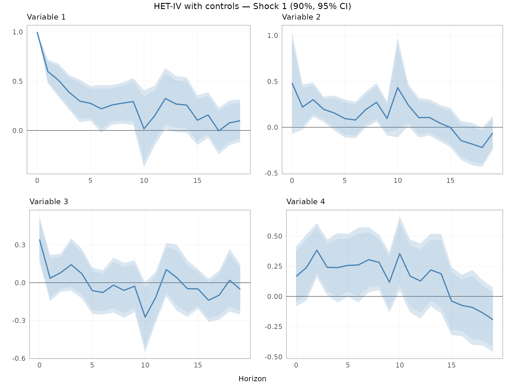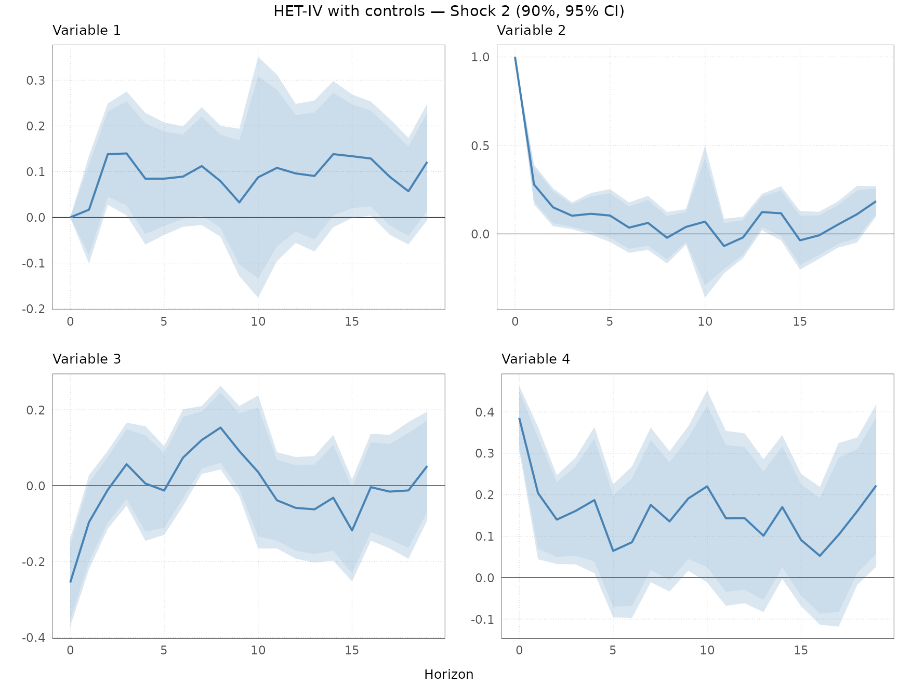

### HET-IV estimates versus true IRF

We can compare the estimates to the true impulse responses by passing a
list of IRFs to
[`plotirf()`](https://dankaufmann.github.io/hetiv/reference/plotirf.md).
We compare the HET-IV estimate (blue) against the theoretical IRF
computed from the known VAR parameters (red). The function
[`computeirf()`](https://dankaufmann.github.io/hetiv/reference/computeirf.md)
computes the theoretical IRF. No standard errors are supplied for the
true IRF, so no confidence bands are plotted for it.

``` r

irf_true <- computeirf(PsiE, Phi, H, cum = FALSE)

plots_vs_true <- plotirf(
  IRF    = list(res_het_X, irf_true),
  HTick  = 5,
  Labels = var_labels,
  ci     = 0.90,
  names  = c("HET-IV with controls", "True"),
  legend = TRUE
)

invisible(arrangeirf(
  plots_vs_true, E = E, N = N, nRows = 2,
  title = paste0("HET-IV with controls vs true IRF — Shock ", seq_len(E), " (90% CI)")
))
```

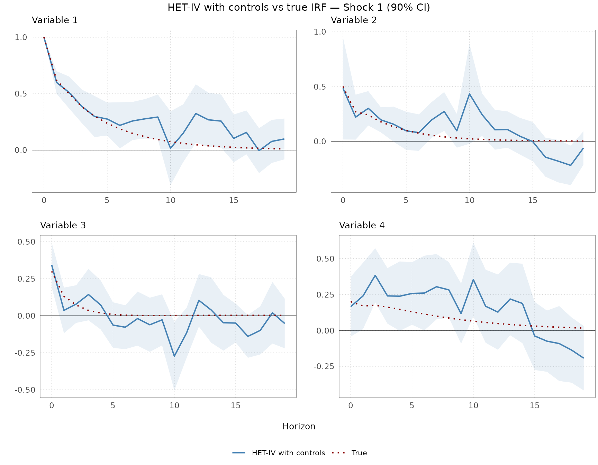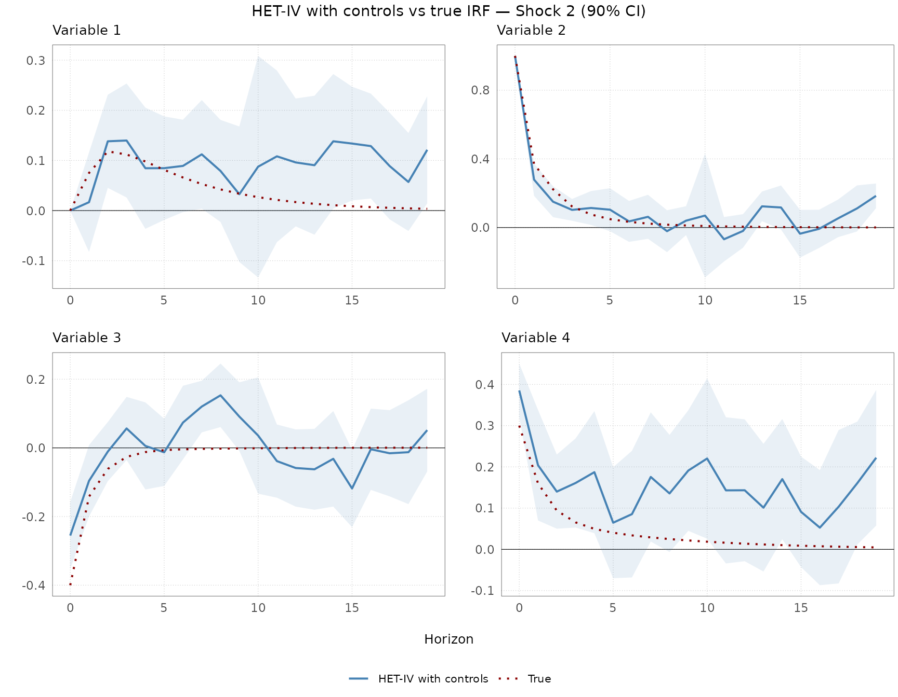

### HET-IV estimates versus misspecified model

We can also compare the accuracy of the estimates using the correct and
misspecified models.

``` r

plots_vs_missp <- plotirf(
  IRF    = list(res_het_X, res_het),
  HTick  = 5,
  Labels = var_labels,
  ci     = 0.90,
  names  = c("With controls", "Without controls"),
  legend = TRUE
)

invisible(arrangeirf(
  plots_vs_missp, E = E, N = N, nRows = 2,
  title = paste0("HET-IV with vs without controls — Shock ", seq_len(E), " (90% CI)")
))
```

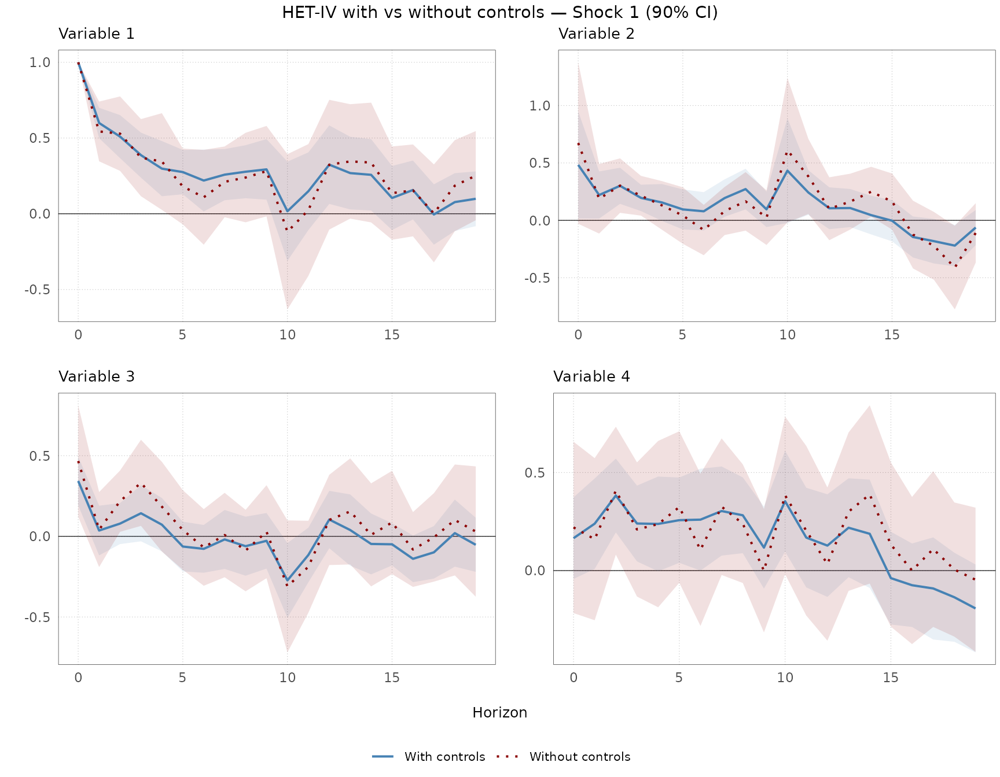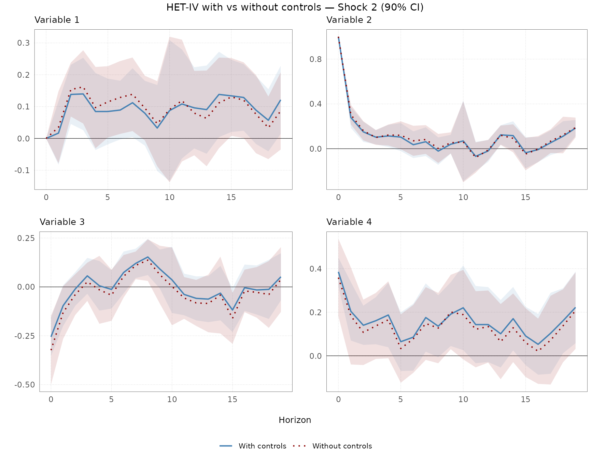

We see that the confidence intervals are wider using the misspecified
model (red). This is especially true for the third and fourth variables
that are affected by the deterministic weekday pattern. The misspecified
model does not account for this pattern, which leads to more uncertainty
and biased estimates. The intervals are also somewhat wider for
variables 1 and 2 because we fail to control for lagged dependent
variables.

### HET-IV versus Proxy-IV

Next, we compare the HET-IV estimates to the Proxy-IV estimates. We
obtain relatively similar point estimates across the two approaches.

``` r

plots_vs_proxy <- plotirf(
  IRF    = list(res_het_X, res_proxy),
  HTick  = 5,
  Labels = var_labels,
  ci     = 0.90,
  names  = c("HET-IV", "Proxy-IV"),
  legend = TRUE
)

invisible(arrangeirf(
  plots_vs_proxy, E = E, N = N, nRows = 2,
  title = paste0("HET-IV vs Proxy-IV — Shock ", seq_len(E), " (90% CI)")
))
```

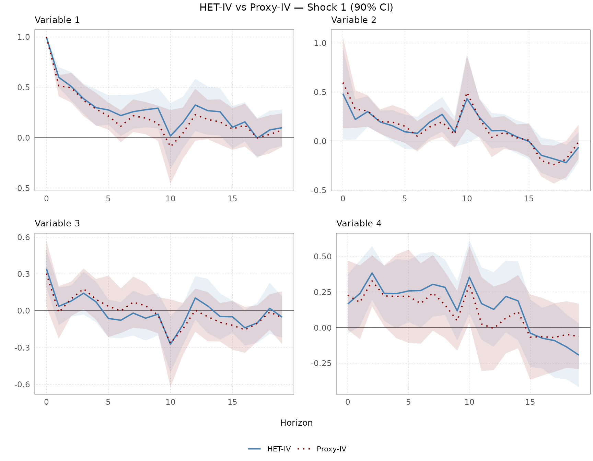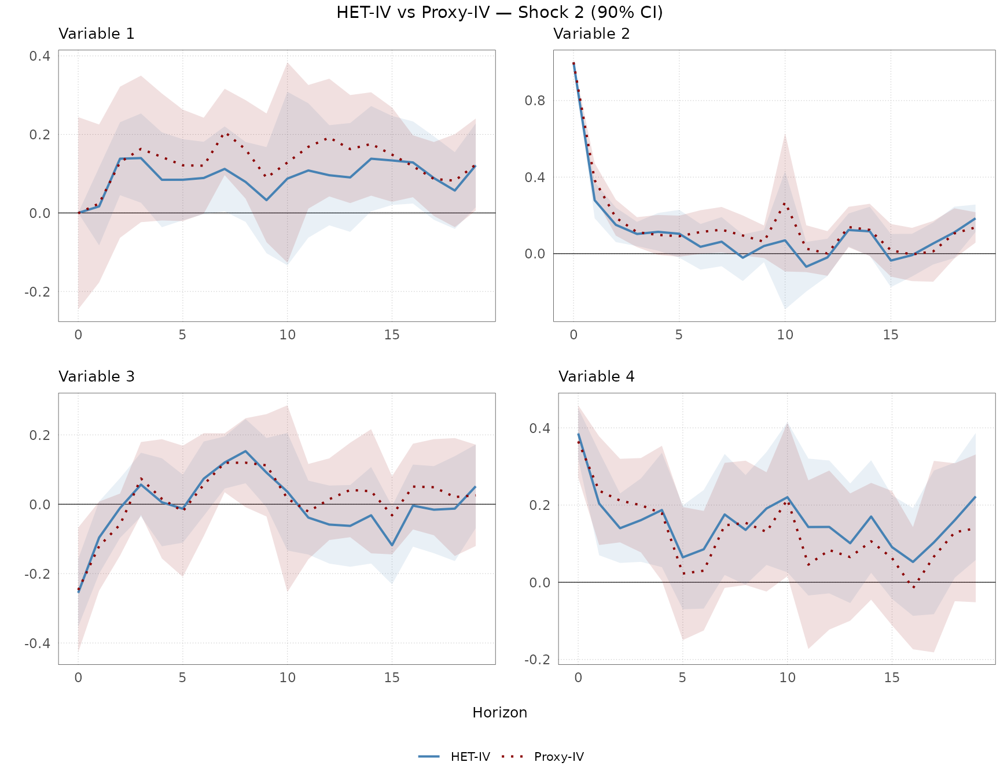

### Proxy-SVAR with bootstrap bands

Finally,
[`svariv()`](https://dankaufmann.github.io/hetiv/reference/svariv.md)
estimates a proxy SVAR (SVAR-IV) following Mertens and Ravn (2013): a
VAR with \\P\\ lags is estimated by OLS on the full sample, the impact
matrix of the first \\E\\ shocks is identified with the external
instruments on the sample where the proxies are observed, and the
impulse responses follow by recursion. With `nboot > 0`, the function
returns the bootstrap draws, from which
[`plotirf()`](https://dankaufmann.github.io/hetiv/reference/plotirf.md)
computes percentile bands centred on the point estimate (or raw
percentile bands with `boot_type = "percentile"`). We compare the
SVAR-IV estimates to the Proxy-IV local projections.

``` r

set.seed(42)
res_svar <- svariv(
  y     = y_data,
  Z     = e_proxy,
  X     = X_data,
  P     = P,
  H     = H,
  E     = E,
  norm  = 1,
  nboot = 200
)

plots_svar <- plotirf(
  IRF    = list(res_svar, res_proxy),
  HTick  = 5,
  Labels = var_labels,
  ci     = 0.90,
  names  = c("SVAR-IV (bootstrap)", "Proxy-IV"),
  legend = TRUE
)

invisible(arrangeirf(
  plots_svar, E = E, N = N, nRows = 2,
  title = paste0("SVAR-IV vs Proxy-IV — Shock ", seq_len(E), " (90% CI)")
))
```

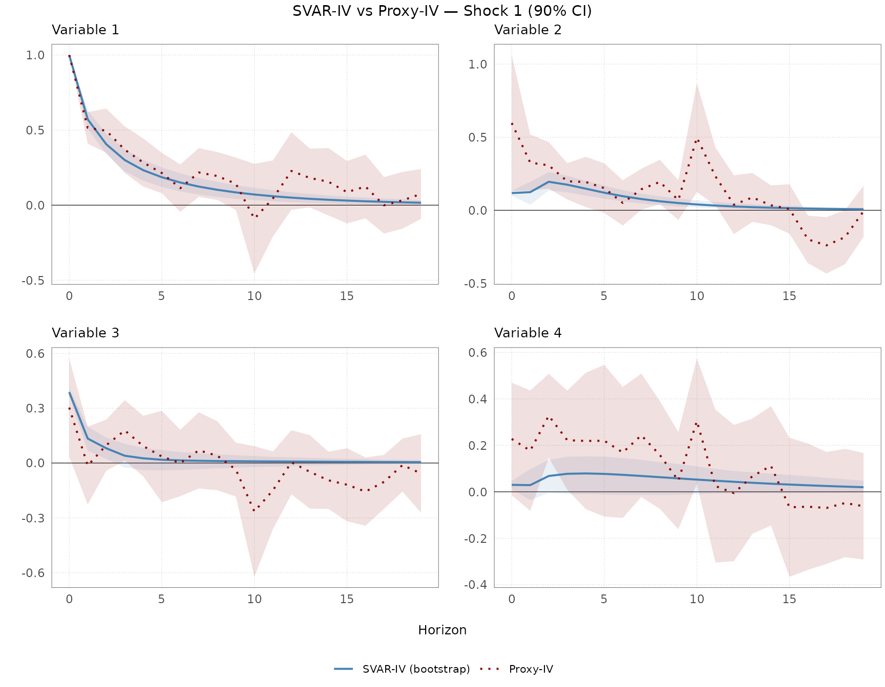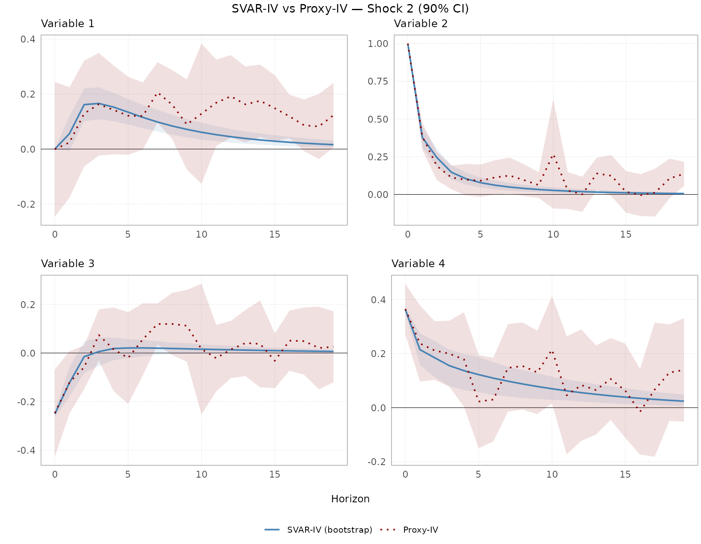

## Shock extraction

[`predict_shocks()`](https://dankaufmann.github.io/hetiv/reference/predict_shocks.md)
recovers structural shocks from reduced-form residuals via a Kalman
filter prediction. It requires the estimated impact matrix `Psi`, the
residual covariance matrices on event and control days (`Sig`, `SigR`),
and the residuals `et`. With `details = TRUE`, the estimators call
[`predict_shocks()`](https://dankaufmann.github.io/hetiv/reference/predict_shocks.md)
automatically and return the predicted shocks as `Shocks`. By default,
the prediction is based on the one-step-ahead residuals and the impact
responses; the option `hpredict` selects a longer horizon instead
(`hpredict = 0` is the impact horizon, matching the row labels of
`irf`).

``` r

shocks_het <- res_het$Shocks
shocks_het_X <- res_het_X$Shocks
shocks_proxy <- res_proxy$Shocks
shocks_proxy_rec <- res_proxy_rec$Shocks

# The same prediction can be obtained by calling predict_shocks() directly
all.equal(
  shocks_het_X,
  predict_shocks(
    Sig = res_het_X$Sig, SigR = res_het_X$SigR,
    Psi = res_het_X$Psi, et = res_het_X$et
  )
)
#> [1] TRUE
```

We assess the accuracy of the predictions by comparing them to the true
event shocks from the underlying model.

``` r

true_shocks <- sim$eE

cor_df1 <- data.frame(
  True = true_shocks[, 1],
  Proxy = e_proxy[, 1],
  HET_IV = shocks_het[, 1],
  HET_IV_X = shocks_het_X[, 1],
  Proxy_IV_X = shocks_proxy[, 1],
  Proxy_IV_Rec = shocks_proxy_rec[, 1]
)

cor_df2 <- data.frame(
  True = true_shocks[, 2],
  Proxy = e_proxy[, 2],
  HET_IV = shocks_het[, 2],
  HET_IV_X = shocks_het_X[, 2],
  Proxy_IV_X = shocks_proxy[, 2],
  Proxy_IV_Rec = shocks_proxy_rec[, 2]
)

tab_all <- data.frame(
  rbind(
    round(cor(cor_df1, use = "complete.obs"), 2)[1, ],
    round(cor(cor_df2, use = "complete.obs"), 2)[1, ]
  )
)
rownames(tab_all) <- c("Shock 1", "Shock 2")

knitr::kable(
  tab_all,
  col.names = c(
    "True", "Proxy", "HET-IV without controls", "HET-IV with controls",
    "Proxy-IV with controls", "Proxy-IV with recursive restriction"
  ),
  row.names = TRUE,
  caption = "Correlation of predicted shocks with true shocks"
)
```

|  | True | Proxy | HET-IV without controls | HET-IV with controls | Proxy-IV with controls | Proxy-IV with recursive restriction |
|:---|---:|---:|---:|---:|---:|---:|
| Shock 1 | 1 | 0.91 | 0.87 | 0.91 | 0.92 | 0.92 |
| Shock 2 | 1 | 0.91 | 0.91 | 0.91 | 0.91 | 0.91 |

Correlation of predicted shocks with true shocks {.table}

The correlation between the true shocks and the proxy is lower than one
due to an attenuation bias (see Burri and Kaufmann, 2026a), which
depends on the variance of the noise term affecting the proxy. The
predictions from the correctly specified models, HET-IV and proxy-IV
with controls, have a correlation of about 0.91 with the true shocks,
similar to the proxy. For the first shock, the correlation is lower if
we use the misspecified model (0.87). The predictions are not perfectly
accurate, because the regular shocks add noise to the forecast errors on
event days. Note that the specific values depend on the exact nature of
the simulated data.

[`plotseries()`](https://dankaufmann.github.io/hetiv/reference/plotseries.md)
plots several series in one panel. Here we compare the predicted first
shock with the true shock on event days. The prediction is rescaled to
the mean and variance of the true shock with
[`rescale_to_match()`](https://dankaufmann.github.io/hetiv/reference/rescale_to_match.md).

``` r

ev <- which(Ind == 1 & !is.na(shocks_het_X[, 1]))
shock_df <- data.frame(
  event      = seq_along(ev),
  true       = true_shocks[ev, 1],
  prediction = rescale_to_match(true_shocks[ev, 1], shocks_het_X[ev, 1])
)

plotseries(
  shock_df,
  x_var    = "event",
  series   = c(true = "True shock", prediction = "Prediction (HET-IV with controls)"),
  x_lab    = "Policy event",
  show_cor = TRUE
)
```

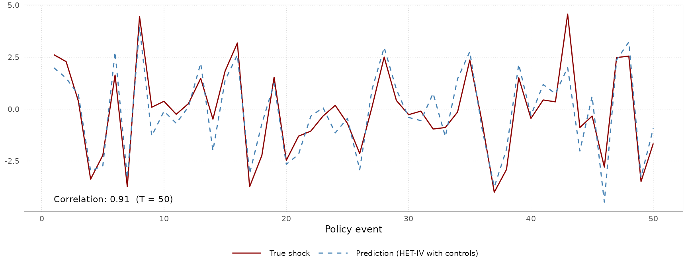

### Prediction from several horizons

By default, the shocks are predicted from the one-step-ahead forecast
errors and the impact responses. The same projection applies to the
forecast errors of `y_{t+h}` given the information dated `t-1`, with the
impact responses replaced by the horizon-`h` responses (`hpredict = h`),
and to the forecast errors of all horizons `0, ..., h` jointly
(`pooled = TRUE`). The pooled prediction weights every horizon by its
signal-to-noise ratio and, in population, has a weakly smaller mean
squared error than the prediction from any single horizon. If all
responses are complete on impact, it coincides with the impact
prediction, and a single later horizon can only add noise.

The pooled prediction requires a nonsingular covariance of the stacked
forecast errors, which is estimated on event days only. A sufficient
condition is that at least as many non-policy shocks as variables drive
the data. The simulated model satisfies this condition, because four
regular shocks drive four variables. The table shows that the pooled
prediction is about as accurate as the impact prediction (a correlation
of 0.88 against 0.91 for both shocks), while the prediction from horizon
2 alone is clearly worse. In this model all responses are complete on
impact, so the later horizons add no information. The small remaining
gap between the pooled and the impact prediction reflects the estimation
of a 12 by 12 covariance from about 50 event days.

``` r

res_het_h2 <- hetiv(
  y = y_data, O = y_data, X = X_data, Ind = Ind, P = P, H = H, E = E,
  norm = 1, hpredict = 2, details = TRUE
)
res_het_pool <- hetiv(
  y = y_data, O = y_data, X = X_data, Ind = Ind, P = P, H = H, E = E,
  norm = 1, hpredict = 2, pooled = TRUE, details = TRUE
)
dim(res_het_pool$Psi) # N(h+1) x E: responses at horizons 0, 1, 2 stacked
#> [1] 12  2

cor_pool <- function(true, r0, r2, rp, k) {
  c(
    Impact   = cor(true[, k], r0$Shocks[, k], use = "complete.obs"),
    Horizon2 = cor(true[, k], r2$Shocks[, k], use = "complete.obs"),
    Pooled   = cor(true[, k], rp$Shocks[, k], use = "complete.obs")
  )
}
tab_pool <- round(rbind(
  cor_pool(true_shocks, res_het_X, res_het_h2, res_het_pool, 1),
  cor_pool(true_shocks, res_het_X, res_het_h2, res_het_pool, 2)
), 2)
rownames(tab_pool) <- c("Shock 1", "Shock 2")
knitr::kable(
  tab_pool,
  col.names = c("Impact (hpredict = 0)", "Horizon 2 (hpredict = 2)", "Pooled (horizons 0-2)"),
  row.names = TRUE,
  caption = "Correlation of predicted shocks with true shocks by prediction horizon (four regular shocks, nonsingular stacked covariance)"
)
```

|  | Impact (hpredict = 0) | Horizon 2 (hpredict = 2) | Pooled (horizons 0-2) |
|:---|---:|---:|---:|
| Shock 1 | 0.91 | 0.71 | 0.88 |
| Shock 2 | 0.91 | 0.49 | 0.88 |

Correlation of predicted shocks with true shocks by prediction horizon
(four regular shocks, nonsingular stacked covariance) {.table}

The condition matters. To illustrate, we simulate a second data set that
differs from the first only in that two of the four regular shocks are
dropped (and without the weekday pattern). Two regular shocks then drive
four variables, so the twelve stacked forecast errors of horizons 0 to 2
are driven by only eight shocks and their covariance is singular.
[`predict_shocks()`](https://dankaufmann.github.io/hetiv/reference/predict_shocks.md)
warns in this case and falls back on a generalised inverse, which makes
the prediction sensitive to estimation error in the responses. The table
shows the consequence. The impact prediction is more accurate than in
the first simulation, because fewer shocks add noise on impact. The
pooled prediction, however, is clearly worse than the impact prediction,
and for the second shock even slightly worse than the prediction from
horizon 2 alone.

``` r

sim2 <- simulatedata(
  Phi = Phi, SigE = SigE, PsiE = PsiE, PsiR = PsiR[, 1:2],
  Nobs = Nobs, Nbin = Nbin, N = N, R = 2, E = E,
  Nevn = Nevn, P = P, eDist = 0, seed = 42
)
y2 <- sim2$y
Ind2 <- as.integer(sim2$IndE[, 1])
fit2 <- function(...) {
  hetiv(y = y2, O = y2, Ind = Ind2, P = P, H = H, E = E, norm = 1, details = TRUE, ...)
}
res2_0 <- fit2()
#> Warning: SigR is (nearly) singular: the smallest eigenvalue of its correlation
#> matrix is 0.00015 relative to the largest. The implied squared correlation is
#> then close to one and overstates the precision of the prediction. This happens
#> when fewer non-policy shocks than variables drive the data.
res2_h2 <- fit2(hpredict = 2)
res2_pool <- fit2(hpredict = 2, pooled = TRUE)
#> Warning: Sig is (nearly) singular: the smallest eigenvalue of its correlation
#> matrix is 1.5e-05 relative to the largest. The generalized inverse regularizes
#> the prediction, which is sensitive to estimation error in Psi. For pooled
#> horizons, the stacked residual covariance is nonsingular only if at least as
#> many non-policy shocks as variables drive the data and the number of complete
#> event days exceeds the number of residual series.
#> Warning: SigR is (nearly) singular: the smallest eigenvalue of its correlation
#> matrix is 8.1e-07 relative to the largest. The implied squared correlation is
#> then close to one and overstates the precision of the prediction. This happens
#> when fewer non-policy shocks than variables drive the data.

tab_pool2 <- round(rbind(
  cor_pool(sim2$eE, res2_0, res2_h2, res2_pool, 1),
  cor_pool(sim2$eE, res2_0, res2_h2, res2_pool, 2)
), 2)
rownames(tab_pool2) <- c("Shock 1", "Shock 2")
knitr::kable(
  tab_pool2,
  col.names = c("Impact (hpredict = 0)", "Horizon 2 (hpredict = 2)", "Pooled (horizons 0-2)"),
  row.names = TRUE,
  caption = "Correlation of predicted shocks with true shocks by prediction horizon (two regular shocks, singular stacked covariance)"
)
```

|  | Impact (hpredict = 0) | Horizon 2 (hpredict = 2) | Pooled (horizons 0-2) |
|:---|---:|---:|---:|
| Shock 1 | 0.99 | 0.80 | 0.83 |
| Shock 2 | 0.95 | 0.56 | 0.51 |

Correlation of predicted shocks with true shocks by prediction horizon
(two regular shocks, singular stacked covariance) {.table}

The pooled prediction is therefore most useful when the responses build
up after the event, so that later horizons carry information that the
impact response misses, and when the number of event days is large
relative to the dimension of the stacked covariance.

### Precision of the prediction

The estimators also report how precise the prediction should be
according to the estimated model: `PredR2` is the squared correlation
between the predicted and the true shock implied by the estimated
responses and covariance matrices (see
[`prediction_corr()`](https://dankaufmann.github.io/hetiv/reference/prediction_corr.md)).
Unlike the correlations above, it does not require the true shocks, so
it is available in applications. The following table compares it with
the realised squared correlation, for the three predictions of the first
simulation.

``` r

# Realised squared correlation of the predictions with the true shocks
realised_r2 <- function(res, true) {
  diag(cor(res$Shocks, true, use = "complete.obs"))^2
}

tab_r2 <- rbind(
  res_het_X$PredR2, realised_r2(res_het_X, true_shocks),
  res_het_h2$PredR2, realised_r2(res_het_h2, true_shocks),
  res_het_pool$PredR2, realised_r2(res_het_pool, true_shocks)
)
rownames(tab_r2) <- paste0(
  rep(c("Impact", "Horizon 2", "Pooled"), each = 2),
  rep(c(": PredR2", ": realised"), 3)
)

knitr::kable(
  tab_r2,
  digits = 2, col.names = c("Shock 1", "Shock 2"),
  caption = "Squared correlation of predicted and true shocks: implied by the estimates (PredR2) and realised"
)
```

|                     | Shock 1 | Shock 2 |
|:--------------------|--------:|--------:|
| Impact: PredR2      |    0.84 |    0.90 |
| Impact: realised    |    0.83 |    0.83 |
| Horizon 2: PredR2   |    0.48 |    0.12 |
| Horizon 2: realised |    0.50 |    0.24 |
| Pooled: PredR2      |    0.86 |    0.91 |
| Pooled: realised    |    0.77 |    0.78 |

Squared correlation of predicted and true shocks: implied by the
estimates (PredR2) and realised {.table}

`PredR2` is close to the realised value for the impact prediction and
correctly indicates that the prediction from horizon 2 alone is much
less precise. For the pooled prediction it is too optimistic. The reason
is that `PredR2` is a population measure evaluated at the estimates: it
ignores estimation error, which is larger for the pooled prediction with
its twelve stacked forecast errors. It is also informative only if the
responses are consistently estimated.

The measure also requires a nonsingular covariance of the forecast
errors on control days. In the second simulation, where two regular
shocks drive four variables, this covariance is nearly singular.
`PredR2` is then close to one whatever the realised accuracy, and the
estimators issue a warning (see the warnings above).

``` r

# Second simulation (two regular shocks): implied and realised
round(rbind(PredR2 = res2_0$PredR2, realised = realised_r2(res2_0, sim2$eE)), 2)
#>          [,1] [,2]
#> PredR2   1.00 1.00
#> realised 0.99 0.89
```

## Weak instrument test

[`gweakivtest()`](https://dankaufmann.github.io/hetiv/reference/gweakivtest.md)
implements the generalised minimum eigenvalue test of Lewis and Mertens
(2025), which is robust to heteroskedasticity and autocorrelation and
applicable to multiple endogenous regressors and multiple instruments.
Note that classical Stock-Yogo (2005) test is applicable only for the
homoskedastic case.

With `details = TRUE`,
[`hetiv()`](https://dankaufmann.github.io/hetiv/reference/hetiv.md) and
[`proxyiv()`](https://dankaufmann.github.io/hetiv/reference/proxyiv.md)
run the weak instrument tests automatically on the sample of every local
projection. For a single shock (`E = 1`), the data frame `FirstStage`
reports, by horizon, the homoskedastic first-stage F statistic (the
squared t statistic of the instrument; Stock and Yogo, 2005) and the
robust effective F statistic of Montiel Olea and Pflueger (2013), always
computed with the HAC (Newey West) covariance estimator, irrespective of
the `cov_type` used for the standard errors. When the proxy is set to
zero on control days, the robust statistic should be preferred: the
homoskedastic F treats the many zero observations as informative and
overstates the strength of the instrument.
[`svariv()`](https://dankaufmann.github.io/hetiv/reference/svariv.md)
reports the same two statistics with `details = TRUE`, using HC0 by
default. For several shocks (`E > 1`), as in this example, the data
frame `WeakTest` reports the generalised minimum eigenvalue statistic
together with its critical values for every shock dimension (`target`),
horizon `h` and outcome variable `i`. For shock dimension `e`, the test
is applied to the system with the first `e` policy variables as
endogenous regressors and the first `e` instruments, and targets the
coefficient on policy variable `e`. The statistic depends on the horizon
only through the estimation sample, whereas the critical values may
differ across outcomes and horizons. The test always uses the HAR (Newey
West) covariance estimator, irrespective of `cov_type`, and the relative
bias criterion, which makes the critical values comparable with those of
Montiel Olea and Pflueger (2013). The test uses a bias tolerance of 10%
at a significance level of 5%. The estimators also return a `WeakData`
data frame with the variables expected by
[`gweakivtest()`](https://dankaufmann.github.io/hetiv/reference/gweakivtest.md)
for custom tests.

The table below shows the test on impact (`h = 0`) for the third
variable for each shock and each of the four specifications.

``` r

specs <- list(
  "HET-IV, no controls" = res_het$WeakTest,
  "HET-IV, with controls" = res_het_X$WeakTest,
  "Proxy-IV, with controls" = res_proxy$WeakTest,
  "Proxy-IV, with controls + recursive restriction" = res_proxy_rec$WeakTest
)

tab <- do.call(rbind, lapply(names(specs), function(nm) {
  r <- specs[[nm]][specs[[nm]]$h == 0 & specs[[nm]]$i == 3, ]
  data.frame(
    Specification = nm,
    Shock = r$target,
    Statistic = round(r$gmin, 2),
    LM_CV = round(r$cv, 2),
    Strong = ifelse(r$gmin > r$cv, "Yes", "No"),
    stringsAsFactors = FALSE
  )
}))

knitr::kable(
  tab,
  col.names = c(
    "Specification", "Shock", "Statistic", "LM critical value",
    "Strong instruments?"
  ),
  caption = "Weak instrument test results on impact (Lewis-Mertens generalised minimum eigenvalue test)"
)
```

| Specification | Shock | Statistic | LM critical value | Strong instruments? |
|:---|---:|---:|---:|:---|
| HET-IV, no controls | 1 | 50.19 | 14.19 | Yes |
| HET-IV, no controls | 2 | 18.71 | 26.80 | No |
| HET-IV, with controls | 1 | 611.74 | 14.19 | Yes |
| HET-IV, with controls | 2 | 165.28 | 28.70 | Yes |
| Proxy-IV, with controls | 1 | 181.42 | 14.19 | Yes |
| Proxy-IV, with controls | 2 | 70.07 | 22.72 | Yes |
| Proxy-IV, with controls + recursive restriction | 1 | 181.42 | 14.19 | Yes |
| Proxy-IV, with controls + recursive restriction | 2 | 70.07 | 22.72 | Yes |

Weak instrument test results on impact (Lewis-Mertens generalised
minimum eigenvalue test) {.table}

All specifications pass the test for the first shock by a wide margin.
For the second shock, the specification without controls is affected by
a weak instrument problem, whereas the correctly specified model passes
the test. Proxy-IV passes the test for the second shock as well, with a
smaller margin than HET-IV with controls. Note that this depends on the
degree of noise used to construct the proxy and does not suggest that
[`hetiv()`](https://dankaufmann.github.io/hetiv/reference/hetiv.md) is
generally superior to
[`proxyiv()`](https://dankaufmann.github.io/hetiv/reference/proxyiv.md).
The recursive restriction does not change the test, because the test
does not depend on the recursive controls: the system for shock `e`
always contains the first `e` policy variables and instruments. In this
example, the critical values are around 14 for the first shock (one
endogenous regressor) and between 23 and 29 for the second shock (two
endogenous regressors). The latter are close to, or somewhat above, the
conservative critical value of the simplified HAR test for the
univariate case by Montiel Olea and Pflueger (2013) and Lewis (2022).
Both are higher than the common rule of thumb of 10 for the Stock and
Yogo (2005) test.

Because the critical values may depend on the outcome variable and the
horizon, it is useful to inspect the full `WeakTest` data frame. The
following table shows, for HET-IV with controls and the second shock,
the statistic and the critical value for the third and fourth variables
at selected horizons.

``` r

wt <- res_het_X$WeakTest
wt <- wt[wt$target == 2 & wt$i %in% c(3, 4) & wt$h %in% c(0, 5, 10, 19), ]
wt$Strong <- ifelse(wt$gmin > wt$cv, "Yes", "No")

knitr::kable(
  wt[, c("h", "i", "Tobs", "gmin", "cv", "Strong")],
  digits = 2, row.names = FALSE,
  col.names = c("Horizon", "Variable", "Obs.", "Statistic", "LM critical value", "Strong instruments?"),
  caption = "Weak instrument test by horizon and outcome variable (HET-IV with controls, second shock)"
)
```

| Horizon | Variable | Obs. | Statistic | LM critical value | Strong instruments? |
|--------:|---------:|-----:|----------:|------------------:|:--------------------|
|       0 |        3 |  498 |    165.28 |             28.70 | Yes                 |
|       5 |        3 |  493 |    170.15 |             27.44 | Yes                 |
|      10 |        3 |  488 |    170.00 |             27.70 | Yes                 |
|      19 |        3 |  479 |    157.93 |             26.87 | Yes                 |
|       0 |        4 |  498 |    165.28 |             28.31 | Yes                 |
|       5 |        4 |  493 |    170.15 |             27.61 | Yes                 |
|      10 |        4 |  488 |    170.00 |             27.46 | Yes                 |
|      19 |        4 |  479 |    157.93 |             27.25 | Yes                 |

Weak instrument test by horizon and outcome variable (HET-IV with
controls, second shock) {.table style="width:100%;"}

## Constructing a proxy from several series

In applications, the proxy is often constructed from a panel of
high-frequency surprises in several financial market series.
[`gss_pca()`](https://dankaufmann.github.io/hetiv/reference/gss_pca.md)
extracts one or two factors from such a panel, following Gurkaynak, Sack
and Swanson (2005). With two factors, the second factor (“path”) is
rotated to have no effect on the first series, so that the first factor
(“target”) is the only one that moves it. Missing values in the panel
are handled by EM principal components.

To illustrate, we simulate six surprise series on the event days. They
are driven by the two event shocks and series-specific noise. The first
series responds to the first shock only.

``` r

set.seed(42)
ev_all <- which(Ind == 1)

# Loadings of the six series on the two event shocks
L_surp <- cbind(
  c(1.0, 0.9, 0.7, 0.5, 0.3, 0.2),
  c(0.0, 0.3, 0.6, 0.8, 1.0, 0.9)
)
surprises <- sim$eE[ev_all, ] %*% t(L_surp) +
  matrix(rnorm(length(ev_all) * 6, sd = 0.5), ncol = 6)
colnames(surprises) <- paste0("s", 1:6)
surprises[c(3, 17), 5] <- NA # some missing observations

factors <- gss_pca(surprises, n_factors = 2)
factors
#> gss_pca: 2 factor(s) [target, path], 50 events x 6 series, 2 missing cells
#> var explained (PC1..PC2): 77.5%, 19.6%
#> path loading on 's1' (target restriction, should be 0): 2.90e-17
#> normalisation: target -> coef 1.000 on 's1'; path -> coef 0.898 on 's2'
#> loadings:
#>    target  path
#> s1  0.461 0.000
#> s2  0.422 0.422
#> s3  0.318 0.790
#> s4  0.233 0.941
#> s5  0.128 1.033
#> s6  0.093 1.069

# Correlation of the factors with the true event shocks
round(cor(factors$factors, sim$eE[ev_all, ]), 2)
#>        [,1] [,2]
#> target 0.98 0.10
#> path   0.00 0.99
```

The factors can be used as proxies in
[`proxyiv()`](https://dankaufmann.github.io/hetiv/reference/proxyiv.md):
place them in a T x 2 matrix `Z` that contains the factors on event days
and zeros on control days.

``` r

Z_gss <- matrix(0, nrow = Nobs, ncol = 2)
Z_gss[ev_all, ] <- factors$factors

res_proxy_gss <- proxyiv(
  y = y_data, O = y_data, Z = Z_gss, Ind = Ind,
  P = P, H = H, E = E, details = TRUE
)
round(res_proxy_gss$PredR2, 2)
#> [1] 0.85 0.88
```

## References

Burri, M. and Kaufmann, D. (2026a). Measuring monetary policy shocks.
*IRENE Working Papers* 24-03, IRENE Institute of Economic Research,
University of Neuchâtel.

Burri, M. and Kaufmann, D. (2026b). Multiple monetary policy shocks from
daily data: A heteroskedasticity IV approach. *Economics Letters*, 268,
113091. <https://doi.org/10.1016/j.econlet.2026.113091>

Gertler, M. and Karadi, P. (2015). Monetary policy surprises, credit
costs, and economic activity. *American Economic Journal:
Macroeconomics*, 7(1), 44–76.

Gürkaynak, R. S., Sack, B. and Swanson, E. T. (2005). Do actions speak
louder than words? The response of asset prices to monetary policy
actions and statements. *International Journal of Central Banking*,
1(1), 55–93.

Jordà, Ò. (2005). Estimation and inference of impulse responses by local
projections. *American Economic Review*, 95(1), 161–182.

Lewis, D. J. (2022). Robust inference in models identified via
heteroskedasticity. *Review of Economics and Statistics*, 104(3),
510–524.

Lewis, D. J. and Mertens, K. (2025). A robust test for weak instruments
for 2SLS with multiple endogenous regressors. *Review of Economic
Studies*, DOI: 10.1093/restud/rdaf103.

Mertens, K. and Ravn, M. O. (2013). The dynamic effects of personal and
corporate income tax changes in the United States. *American Economic
Review*, 103(4), 1212–1247.

Montiel Olea, J. L. and Pflueger, C. E. (2013). A robust test for weak
instruments. *Journal of Business & Economic Statistics*, 31(3),
358-369.

Montiel Olea, J. L., M. Plagborg-Møller, E. Qian, C. K. Wolf (2025).
*Local projections or VARs? A primer for macroeconomists*. NBER
Macroeconomics Annual 2025, vol. 40, pp. 1-64, National Bureau of
Economic Research.

Nakamura, E. and Steinsson, J. (2018). High-frequency identification of
monetary non-neutrality: The information effect. *Quarterly Journal of
Economics*, 133(3), 1283–1330.

Rigobon, R. (2003). Identification through heteroskedasticity. *Review
of Economics and Statistics*, 85(4), 777–792.

Stock, J. H. and Watson, M. W. (2018). Identification and estimation of
dynamic causal effects in macroeconomics using external instruments.
*Economic Journal*, 128(610), 917–948.

Stock, J. H. and Yogo, M. (2005). Testing for weak instruments in linear
IV regression. In D. W. K. Andrews and J. H. Stock (Eds.),
*Identification and inference for econometric models*, pp. 80–108.
Cambridge University Press.
